# 企业级知识库平台后端 API 优先模块级详细功能设计 V6

版本：V6.0  
定位：后端业务能力平台 + Knowledge API Platform + 架构落地设计 + 研发开工规格  
核心原则：准确率优先、权限先行、证据可追溯、知识可更新、轻量本体增强、Elasticsearch 统一检索

---

## 0. 文档目标

这份文档用于把企业级知识库平台从“总体设想”推进到“可设计、可拆解、可开发、可验收”的程度。

文档不只描述平台应该有什么功能，还明确每个模块应该怎么落地：

1. 对外 API 怎么设计。
2. 后端服务怎么拆。
3. 核心数据表怎么建。
4. Elasticsearch 字段怎么投影。
5. 权限、审计、幂等、限流、错误码怎么统一。
6. 后台任务怎么跑。
7. 状态机怎么流转。
8. 异常和低置信度场景怎么处理。
9. 准确率、权限和知识更新怎么验收。
10. 最小管理页面保留哪些。

平台目标不是做一个“上传文件后聊天”的页面产品，而是建设企业级知识后端能力底座：

> 把企业内部文档、制度、流程、图纸、工艺、报价、合同、工单、异常、供应商、审计、HR、数字员工运行记录和专家经验，变成可检索、可问答、可追溯、可更新、可运营、可评测、可审计的知识资产。

对外使用形态以接口为主：

1. 企业内部系统通过 API 接入知识检索、问答、证据、知识更新和相似案例能力。
2. AI Agent、数字员工、RPA、业务助手通过 Agent Context API 获取授权上下文。
3. 外部应用不直接访问底层 ES、数据库或模型，只访问平台暴露的受控 API。
4. 基础页面只用于管理、配置、排障、审计、评测和简单演示。

---

## 1. 总体落地原则

### 1.1 准确率第一

平台所有模块都要服务于准确率，而不是只追求回答流畅。

必须坚持：

| 原则 | 落地方式 |
|---|---|
| 无证据不回答 | RAG 必须基于授权证据生成，证据不足时拒答 |
| 证据可追溯 | 每个答案必须保存 Evidence Pack |
| 权限先行 | 检索前先生成权限过滤条件，未授权内容不能进入召回、重排、Prompt |
| 新鲜度约束 | 过期、被替代、冲突、待复审知识不能被当成当前有效结论 |
| 官方知识优先 | 官方答案、有效版本、权威来源在排序和回答中优先 |
| 不确定性显式表达 | 低置信度、证据冲突、版本不确定时必须提示 |

### 1.2 平台级能力先于单点功能

平台不是一个问答页面，而是一组可复用的知识基础设施：

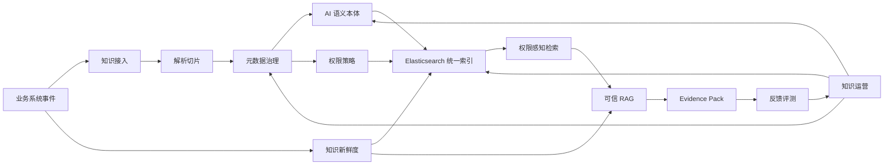

### 1.3 统一模块设计模板

后续每个模块都按以下模板设计：

| 设计项 | 需要回答的问题 |
|---|---|
| 模块目标 | 模块解决什么业务问题 |
| 调用方动作 | 业务系统、Agent、管理员或运营人员如何使用 |
| 后台服务 | 需要哪些服务和任务 |
| 数据对象 | 需要哪些核心表和字段 |
| ES 投影 | 哪些字段要进入 Elasticsearch |
| API | 对业务系统、Agent、管理后台暴露什么接口 |
| 接口治理 | 鉴权、租户、幂等、错误码、限流、审计如何处理 |
| 状态机 | 关键对象有哪些状态 |
| 准确率机制 | 如何避免错答、漏答、旧答、越权答 |
| 异常处理 | 失败、冲突、低置信度、权限异常怎么办 |
| 验收标准 | 怎么判断模块做对了 |

### 1.4 后端 API 优先定位

本平台的核心产品不是复杂前端，而是一组可被企业应用调用的知识能力 API。

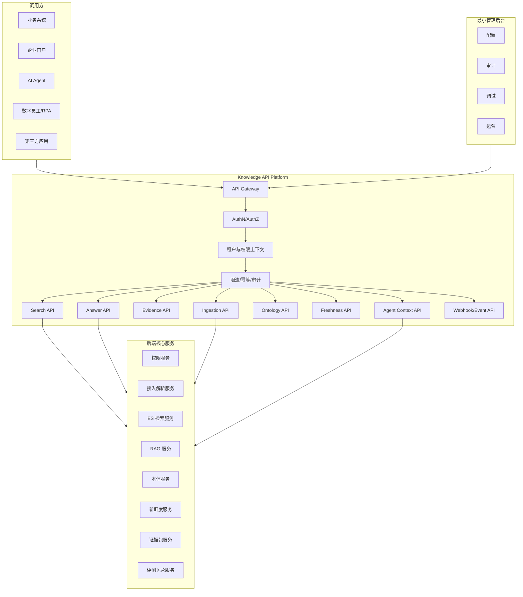

接口优先带来的设计要求：

| 要求 | 说明 |
|---|---|
| API 契约稳定 | 接口版本、请求结构、响应结构、错误码必须稳定 |
| 权限上下文显式 | 每次调用都必须明确调用方、租户、用户、目的和权限范围 |
| 异步任务标准化 | 文档解析、索引重建、批量导入、评测等必须走 Job 模型 |
| Evidence Pack 标准化 | 所有高价值回答和推荐都返回 evidence_pack_id |
| 可观测性内建 | 每次调用都要有 request_id、trace_id、audit_id |
| 对接友好 | 提供 OpenAPI 文档、SDK、Webhook、示例和沙箱环境 |
| 页面最小化 | 页面只服务管理、运营和排障，不把复杂业务流程放在前端 |

---

## 2. 总体模块划分

平台建议拆成 15 个后端业务核心模块，并在最外层统一通过 API 交付层对外提供能力。

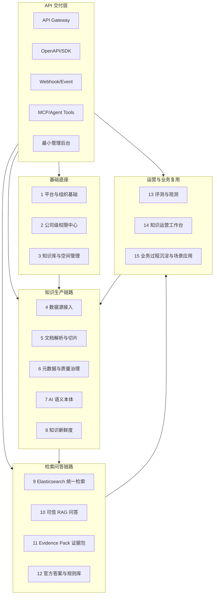

---

## 3. 模块一：平台与组织基础

### 3.1 模块目标

平台与组织基础模块负责企业级知识库的组织边界、用户身份、租户隔离、工作区划分和基础配置。

它要解决的问题：

1. 多公司、多事业中心、多部门、多团队如何隔离和协作。
2. 用户、组织、角色、知识库、数据源之间如何建立统一身份。
3. 后续权限、检索、审计、统计如何拿到稳定的组织上下文。

### 3.2 用户侧功能

管理员需要能完成：

1. 创建租户或企业空间。
2. 配置工作区，例如研发知识空间、售后知识空间、制造知识空间。
3. 同步组织架构。
4. 查看组织树：公司、事业中心、部门、团队、人员。
5. 配置默认角色。
6. 设置平台级安全策略。
7. 设置知识库分类、标签、密级等级、默认语言、默认解析策略。

普通用户需要能完成：

1. 进入自己有权限的知识空间。
2. 查看自己所属组织、角色、可访问知识库。
3. 申请加入某个知识库或申请临时权限。

### 3.3 后台服务拆分

| 服务 | 职责 |
|---|---|
| TenantService | 租户、企业空间、隔离策略 |
| WorkspaceService | 工作区创建、归属、配置 |
| OrgSyncService | 组织架构同步、差异比对 |
| UserService | 用户、账号、身份映射 |
| RoleService | 平台角色、业务角色 |
| ConfigService | 全局配置、模块开关、安全策略 |
| AuditService | 组织和配置变更审计 |

### 3.4 核心数据表

| 表 | 关键字段 | 说明 |
|---|---|---|
| tenant | id, name, status, isolation_mode, created_at | 企业租户 |
| workspace | id, tenant_id, name, owner_id, visibility, status | 工作区 |
| org_unit | id, tenant_id, parent_id, type, name, code, path | 组织单元，type 包括 company、business_center、department、team |
| user_account | id, tenant_id, username, display_name, email, mobile, status | 用户账号 |
| user_org_binding | user_id, org_unit_id, is_primary, position, start_at, end_at | 用户组织归属 |
| role | id, tenant_id, code, name, scope, status | 角色 |
| user_role_binding | user_id, role_id, scope_type, scope_id | 用户角色绑定 |
| platform_config | tenant_id, config_key, config_value, version | 平台配置 |
| audit_log | id, tenant_id, actor_id, action, target_type, target_id, before, after, created_at | 审计 |

### 3.5 组织同步流程

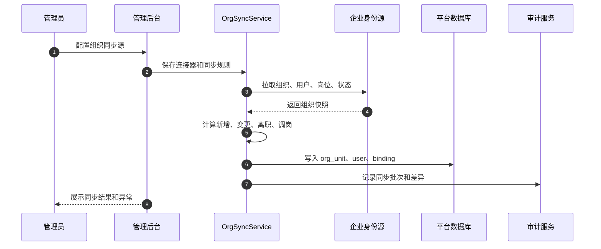

### 3.6 关键配置项

| 配置项 | 示例 | 用途 |
|---|---|---|
| org_sync_mode | full、incremental | 组织同步方式 |
| default_security_level | internal | 新知识库默认密级 |
| default_permission_mode | deny_by_default | 默认无权限 |
| evidence_retention_days | 1095 | Evidence Pack 保存期限 |
| answer_policy | strict | 问答严格程度 |
| stale_policy | warn_or_block | 过期知识处理 |

### 3.7 验收标准

1. 同一个用户在不同工作区下有效身份可区分。
2. 组织调整后，权限计算能在配置 SLA 内生效。
3. 用户离职或禁用后，搜索、问答、下载、API 立即不可用或在安全 SLA 内失效。
4. 所有组织、角色、配置变更都有审计日志。

---

## 4. 模块二：公司级权限中心

### 4.1 模块目标

权限中心是企业知识库的安全核心。

它要支持按以下维度精细控制：

1. 租户。
2. 工作区。
3. 知识库。
4. 文件夹。
5. 文档。
6. Chunk。
7. 事业中心。
8. 具体部门。
9. 具体团队。
10. 自定义人员集合。
11. 单个用户。
12. 角色。
13. 用户组。
14. 临时授权。
15. API Key。
16. Agent 身份。

权限必须在检索前生效。不能先召回再过滤。

### 4.2 权限动作模型

权限动作必须拆细，不能只做“可见/不可见”。

| 动作 | 含义 |
|---|---|
| view | 查看文档详情 |
| search | 出现在搜索结果中 |
| ask | 可进入 RAG Prompt |
| cite | 可作为引用展示 |
| download | 下载原文件 |
| share | 分享链接 |
| manage | 管理知识库或文档 |
| authorize | 配置权限 |
| publish_official | 发布官方答案 |
| review | 审核知识 |
| export | 导出结果或证据 |
| api_call | API 调用 |
| agent_call | Agent 调用 |

典型规则：

1. 有 view 不等于有 ask。
2. 有 search 不等于有 download。
3. 有 cite 必须同时满足 view 或 ask 策略。
4. Agent 调用必须同时满足 Agent 权限和被委托用户权限。

### 4.3 权限策略数据结构

```json
{
  "policy_id": "pol_001",
  "tenant_id": "t_001",
  "target_type": "document",
  "target_id": "doc_001",
  "effect": "allow",
  "actions": ["view", "search", "ask", "cite"],
  "subjects": [
    {"type": "business_center", "id": "bc_rd"},
    {"type": "department", "id": "dept_quality"},
    {"type": "team", "id": "team_after_sales"},
    {"type": "custom_person_set", "id": "set_project_a"},
    {"type": "user", "id": "u_001"}
  ],
  "conditions": {
    "security_level_lte": "confidential",
    "time_range": ["2026-01-01T00:00:00+08:00", "2026-12-31T23:59:59+08:00"],
    "source_system": ["plm", "ticket"]
  },
  "priority": 100,
  "reason": "项目协作授权"
}
```

### 4.4 核心数据表

| 表 | 关键字段 | 说明 |
|---|---|---|
| permission_policy | id, tenant_id, target_type, target_id, effect, actions, priority, status | 权限策略主表 |
| permission_subject | policy_id, subject_type, subject_id | 授权主体 |
| permission_condition | policy_id, condition_key, operator, condition_value | 条件表达式 |
| custom_person_set | id, tenant_id, name, owner_id, status | 自定义人员集合 |
| custom_person_member | set_id, user_id, start_at, end_at | 集合成员 |
| temporary_authorization | id, requester_id, approver_id, target_type, target_id, actions, start_at, end_at, reason, status | 临时授权 |
| api_key_identity | id, tenant_id, app_name, scope, status, expires_at | API 身份 |
| agent_identity | id, tenant_id, agent_name, allowed_actions, allowed_scope, status | Agent 身份 |
| effective_permission_cache | subject_hash, action, target_scope, filter_json, version, expires_at | 有效权限缓存 |

### 4.5 权限计算流程

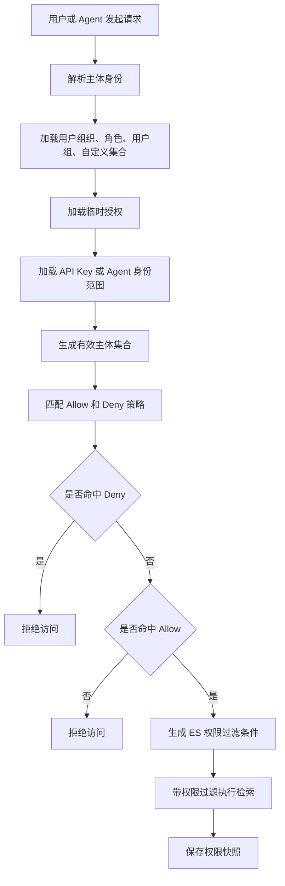

### 4.6 ES 权限字段设计

文档索引和 Chunk 索引必须保留可查询权限字段。

| 字段 | 类型 | 说明 |
|---|---|---|
| tenant_id | keyword | 租户 |
| workspace_id | keyword | 工作区 |
| security_level | keyword | 密级 |
| allowed_users | keyword[] | 显式允许用户 |
| denied_users | keyword[] | 显式拒绝用户 |
| allowed_org_units | keyword[] | 允许组织单元 |
| denied_org_units | keyword[] | 拒绝组织单元 |
| allowed_roles | keyword[] | 允许角色 |
| allowed_groups | keyword[] | 允许用户组 |
| allowed_person_sets | keyword[] | 允许自定义人员集合 |
| ask_allowed | boolean | 是否可进 RAG |
| download_allowed | boolean | 是否可下载 |
| permission_version | long | 权限版本 |

权限过滤示意：

```json
{
  "bool": {
    "filter": [
      {"term": {"tenant_id": "t_001"}},
      {"terms": {"workspace_id": ["ws_rd"]}},
      {
        "bool": {
          "should": [
            {"terms": {"allowed_users": ["u_001"]}},
            {"terms": {"allowed_org_units": ["bc_rd", "dept_quality", "team_after_sales"]}},
            {"terms": {"allowed_roles": ["quality_engineer"]}},
            {"terms": {"allowed_person_sets": ["set_project_a"]}}
          ],
          "minimum_should_match": 1
        }
      }
    ],
    "must_not": [
      {"terms": {"denied_users": ["u_001"]}},
      {"terms": {"denied_org_units": ["dept_restricted"]}}
    ]
  }
}
```

### 4.7 权限管理后台面板

权限中心在最小管理后台中需要 5 个基础面板：

| 面板 | 主要功能 |
|---|---|
| 权限策略列表 | 查看、筛选、复制、停用策略 |
| 策略编辑页 | 选择目标、主体、动作、条件、生效期、审批人 |
| 自定义人员集合 | 创建项目组、专项组、外协组等虚拟集合 |
| 临时授权 | 申请、审批、到期、撤销、审计 |
| 权限模拟器 | 输入用户和目标文档，解释为什么有权或无权 |

权限模拟器很重要，企业系统一旦权限复杂，必须能解释：

1. 用户属于哪些事业中心、部门、团队。
2. 命中了哪些 allow 策略。
3. 命中了哪些 deny 策略。
4. 临时授权是否有效。
5. 是否因为密级被拦截。
6. 最终是否允许 search、ask、download。

### 4.8 验收标准

1. 未授权内容不能出现在搜索结果、RAG Prompt、引用、摘要和推荐中。
2. Deny 优先于 Allow。
3. 临时授权到期后自动失效。
4. 用户组织变更后，权限结果可刷新。
5. 权限模拟器能解释每次权限判断。
6. Evidence Pack 保存当次权限快照。

---

## 5. 模块三：知识库与空间管理

### 5.1 模块目标

知识库管理模块负责把企业知识按业务域、密级、来源、责任人和使用场景组织起来。

知识库不是简单文件夹，它应该是一个带策略的知识容器。

### 5.2 知识库类型

| 类型 | 内容 | 关键策略 |
|---|---|---|
| 制度流程知识库 | 制度、SOP、流程说明 | 强版本、强生效期 |
| 研发图纸知识库 | 图纸、BOM、工艺参数 | 强权限、强版本 |
| 售后案例知识库 | 工单、故障、解决方案 | 强相似推荐 |
| 生产异常知识库 | 异常、根因、处置、复盘 | 强结构化 |
| 报价知识库 | 报价规则、价格说明、方案模板 | 高密级 |
| 财务审计知识库 | 审计规则、凭证说明、风险案例 | 高审计 |
| HR 行政知识库 | 流程、材料、入口、政策 | 强新鲜度 |
| 供应商知识库 | 供应商能力、交期、质量、替代 | 强关系 |
| 数字员工知识库 | RPA 流程、异常、修复方案 | 强运行日志关联 |

### 5.3 知识库创建字段

| 字段 | 说明 |
|---|---|
| name | 知识库名称 |
| business_domain | 业务域 |
| owner_org_unit_id | 责任组织 |
| owner_user_id | 责任人 |
| security_level | 默认密级 |
| default_permission_policy_id | 默认权限策略 |
| parser_policy_id | 默认解析策略 |
| chunk_policy_id | 默认切片策略 |
| freshness_policy_id | 默认新鲜度策略 |
| ontology_policy_id | 默认本体抽取策略 |
| rag_policy_id | 默认问答策略 |
| official_policy_enabled | 是否允许官方答案 |

### 5.4 后台服务

| 服务 | 职责 |
|---|---|
| KnowledgeBaseService | 知识库 CRUD、配置、归档 |
| FolderService | 文件夹和路径管理 |
| DocumentCatalogService | 文档目录、版本、状态 |
| PolicyBindingService | 权限、解析、切片、新鲜度、本体策略绑定 |
| DashboardService | 知识库统计和健康度 |

### 5.5 知识库状态机

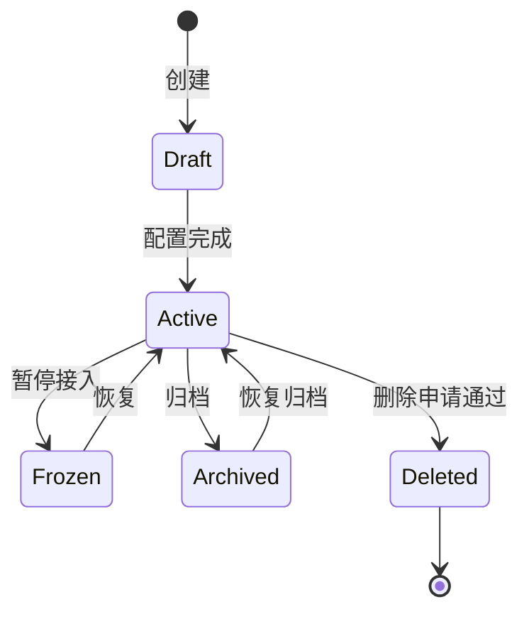

### 5.6 知识库管理后台面板

知识库详情页建议采用以下结构：

1. 概览：文档数、Chunk 数、可问答数量、过期数量、冲突数量、质量分。
2. 文档：文件、版本、解析状态、索引状态、权限、责任人。
3. 权限：继承策略、覆盖策略、临时授权。
4. 数据源：连接器、同步状态、失败记录。
5. 策略：解析策略、切片策略、本体策略、新鲜度策略、RAG 策略。
6. 运营：待复审、冲突、低质量、用户反馈。
7. 评测：该知识库相关黄金问题集和准确率。

### 5.7 验收标准

1. 创建知识库时必须绑定责任人和默认权限。
2. 知识库下所有文档必须继承基础策略，除非显式覆盖。
3. 知识库删除或归档后，不再进入检索和 RAG。
4. 知识库概览能显示健康度和风险项。

---

## 6. 模块四：数据源接入

### 6.1 模块目标

数据源接入模块负责把企业知识从多个来源稳定进入平台。

接入对象包括：

1. 本地上传文件。
2. 网盘和文档系统。
3. Wiki 和在线文档。
4. 工单系统。
5. PLM、PDM、MES、ERP、CRM、SRM、HR、财务、审计系统。
6. 邮件、IM 群文件。
7. API 事件。
8. 数字员工运行日志。

### 6.2 数据源连接器模型

| 字段 | 说明 |
|---|---|
| connector_id | 连接器 ID |
| source_type | 数据源类型 |
| auth_type | OAuth、API Key、账号密码、内网代理 |
| sync_mode | full、incremental、event |
| schedule | 同步计划 |
| source_scope | 同步范围 |
| permission_sync_mode | 是否同步源权限 |
| metadata_mapping | 元数据映射规则 |
| file_filter | 文件类型、目录、大小过滤 |
| status | 启用、暂停、异常 |

### 6.3 接入标准流程

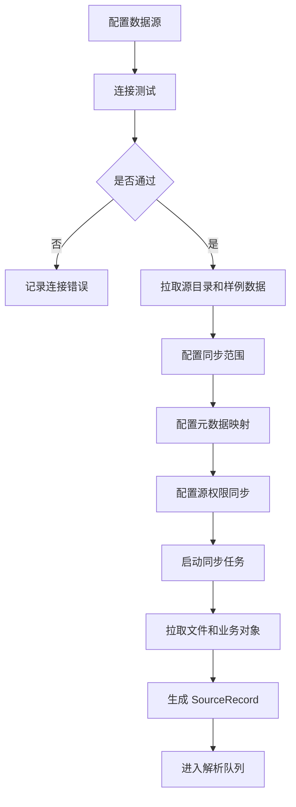

### 6.4 核心数据表

| 表 | 关键字段 | 说明 |
|---|---|---|
| data_source | id, tenant_id, source_type, name, owner_id, status | 数据源 |
| data_connector_config | source_id, auth_config, sync_config, filter_config | 连接器配置 |
| source_record | id, source_id, source_object_id, source_path, checksum, version, status | 源记录 |
| sync_job | id, source_id, mode, started_at, finished_at, status | 同步任务 |
| sync_job_item | job_id, source_record_id, action, status, error_code | 同步明细 |
| source_permission_snapshot | source_record_id, permission_json, captured_at | 源权限快照 |

### 6.5 增量同步策略

增量同步至少支持 4 种机制：

| 机制 | 适用场景 |
|---|---|
| updated_at 游标 | 大多数业务系统 |
| checksum 比对 | 文件类数据源 |
| version 比对 | PLM、制度、规则 |
| event webhook | 工单关闭、图纸发布、流程变更 |

### 6.6 接入失败处理

| 失败类型 | 处理方式 |
|---|---|
| 鉴权失败 | 暂停同步，通知数据源负责人 |
| 文件下载失败 | 重试，超过阈值进入失败队列 |
| 权限同步失败 | 不允许进入可检索状态 |
| 元数据缺失 | 标记 low_metadata_quality，进入运营任务 |
| 文件过大 | 分片或转异步任务 |
| 版本冲突 | 建立冲突任务，等待确认 |

### 6.7 验收标准

1. 每个源记录都能追溯到原始系统、路径、版本和同步批次。
2. 权限同步失败的数据不能直接进入 RAG。
3. 增量同步不能重复生成同一版本。
4. 接入失败必须可重试、可定位、可审计。

---

## 7. 模块五：文档解析、切片与元数据

### 7.1 模块目标

解析切片模块负责把原始资料转换为机器可检索、可引用、可问答、可更新的知识单元。

核心目标：

1. 保留原文结构。
2. 保留页码、段落、表格区域、标题层级。
3. 不把完整业务语义切碎。
4. 让 Chunk 能继承权限、版本、新鲜度、来源和责任人。

### 7.2 解析对象

| 类型 | 解析重点 |
|---|---|
| PDF | 页码、标题、段落、表格、图片 OCR |
| Word | 标题层级、段落、表格、批注、修订 |
| 表格文件 | Sheet、表头、单元格区域、合并单元格 |
| PPT | 页、标题、图表、备注 |
| Markdown/HTML | 标题树、代码块、表格、链接 |
| 图纸 | 图号、版本、材料、尺寸、工艺、审批 |
| 工单 | 问题、现象、原因、处理、结果 |
| 业务记录 | 字段映射、状态、时间、责任人 |

### 7.3 解析流水线

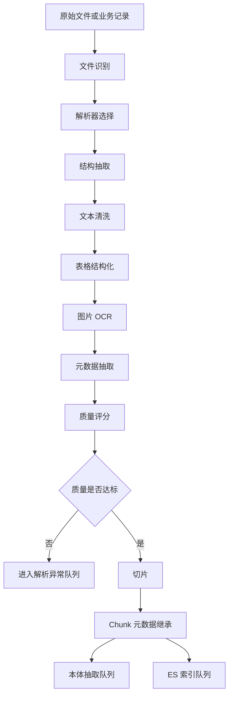

### 7.4 Chunk 设计

Chunk 不应该只是固定长度切割。企业知识需要按结构切片。

| Chunk 类型 | 切片规则 |
|---|---|
| section_chunk | 按标题章节切 |
| paragraph_chunk | 按段落切 |
| table_chunk | 按表格或表格区域切 |
| qa_chunk | 按问答对切 |
| procedure_chunk | 按流程步骤切 |
| case_chunk | 按问题、原因、方案、结果切 |
| rule_chunk | 按规则条件和适用范围切 |
| drawing_chunk | 按图号、版本、部件、参数切 |

### 7.5 Chunk 字段

| 字段 | 说明 |
|---|---|
| chunk_id | Chunk ID |
| document_id | 文档 ID |
| version_id | 文档版本 |
| chunk_type | section、table、case、rule 等 |
| chunk_text | 文本 |
| heading_path | 标题路径 |
| page_start/page_end | 页码 |
| paragraph_start/paragraph_end | 段落位置 |
| table_region | 表格区域 |
| source_location | 原文定位 |
| inherited_permission_version | 继承权限版本 |
| freshness_status | 新鲜度状态 |
| quality_score | 解析质量 |

### 7.6 元数据抽取

必须抽取三类元数据：

| 元数据类型 | 示例 |
|---|---|
| 来源元数据 | 数据源、路径、文件名、版本、创建时间、修改时间 |
| 业务元数据 | 客户、产品、图号、物料号、工单号、报价号、合同号 |
| 治理元数据 | 密级、责任人、有效期、复审周期、官方状态 |

### 7.7 解析质量评分

解析完成后生成 quality_score。

建议评分项：

| 维度 | 权重 | 说明 |
|---|---:|---|
| 文本完整度 | 25 | 是否提取出主要正文 |
| 结构完整度 | 20 | 标题、段落、表格是否保留 |
| 表格可用性 | 15 | 表头和单元格是否可理解 |
| OCR 质量 | 10 | 图片文字识别可信度 |
| 元数据完整度 | 15 | 来源、版本、责任人、时间是否完整 |
| 可引用性 | 15 | 能否定位到页码、段落或表格 |

低于阈值的文档不能直接作为高置信答案来源。

### 7.8 验收标准

1. 答案引用能跳转到原文页码或段落。
2. 表格内容不被切成无法理解的碎片。
3. Chunk 能继承权限、来源、版本、新鲜度。
4. 解析失败能定位失败原因并重试。

---

## 8. 模块六：元数据与质量治理

### 8.1 模块目标

元数据和质量治理模块负责让知识可管理、可排序、可追责、可更新。

没有元数据，知识库会很快变成无法判断可信度的文件堆。

### 8.2 元数据分层

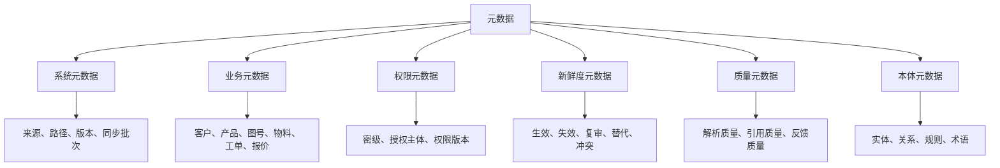

### 8.3 元数据补全策略

| 缺失项 | 补全方式 |
|---|---|
| 责任人缺失 | 继承知识库责任人或数据源负责人 |
| 密级缺失 | 继承知识库默认密级 |
| 业务编号缺失 | 从文件名、正文、路径、源系统字段抽取 |
| 生效期缺失 | 根据知识类型设置默认复审周期 |
| 版本缺失 | 使用 checksum 和更新时间生成版本 |
| 部门缺失 | 根据上传人或源系统归属推断 |

### 8.4 质量状态

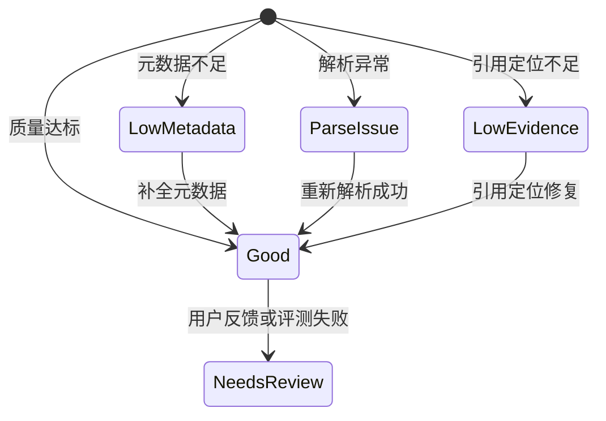

### 8.5 后台任务

| 任务 | 频率 | 作用 |
|---|---|---|
| metadata_completeness_scan | 每日 | 扫描元数据缺失 |
| parse_quality_scan | 每日 | 发现解析低质文档 |
| duplicate_detection_job | 每日 | 发现重复文件和重复内容 |
| owner_missing_job | 每日 | 发现无责任人知识 |
| quality_score_recalc | 事件触发 | 更新质量分 |

### 8.6 验收标准

1. 每个可问答 Chunk 必须有来源、版本、权限、新鲜度和质量分。
2. 低质量知识可以被搜索，但不能直接生成高置信答案。
3. 元数据缺失必须进入运营任务池。

---

## 9. 模块七：AI 语义本体

### 9.1 模块目标

AI 语义本体不是要做一个让管理员天天维护的大型知识图谱，而是做一层轻量的企业语义层。

它的作用是让平台知道：

1. 文档里说的“对象”是什么。
2. 对象之间有什么关系。
3. 哪些知识适用于哪些业务范围。
4. 哪些版本替代了旧版本。
5. 哪些规则有生效期、例外条件和责任部门。
6. 用户问的问题对应哪些业务对象。
7. 检索和回答时应该优先找哪些证据。
8. 不同文档之间是否存在替代、引用、冲突、补充、证明、依赖等跨文档关系。

通俗地说：

> 本体不是让用户多干活，而是让系统更懂企业业务语义，从而提升检索、问答、更新、推荐和准确率。

### 9.2 本体建设原则

| 原则 | 说明 |
|---|---|
| 自动优先 | 默认由系统抽取实体、关系、规则、同义词 |
| 弱绑定默认 | 普通知识不需要人工确认即可用于搜索增强 |
| 强治理关键知识 | 图纸、报价、财务、制度、工艺、官方答案必须强治理 |
| 只管高价值关系 | 不追求把所有知识都画成图 |
| 与业务系统对齐 | 客户、产品、物料、图号等优先使用业务系统主数据 |
| 可解释 | 每个实体和关系必须能追溯来源 |
| 可投影 | 本体结果要能进入 ES 字段、RAG 证据和新鲜度判断 |

### 9.3 六类本体模型

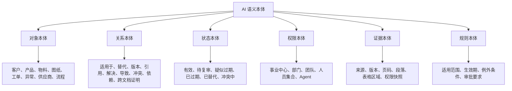

### 9.4 本体对象模型

#### 9.4.1 OntologyType

定义企业允许识别的对象类型。

| 字段 | 示例 |
|---|---|
| type_code | product_model |
| type_name | 产品型号 |
| category | object |
| extraction_policy | regex + llm + dictionary |
| governance_level | weak_by_default |
| owner_org_unit_id | 产品管理部 |

建议第一阶段内置类型：

| 类型 | 示例 |
|---|---|
| customer | 客户名称、客户编码 |
| product_model | 产品型号 |
| material_code | 物料编码 |
| drawing_no | 图号 |
| work_order_no | 工单号 |
| exception_code | 异常代码 |
| supplier | 供应商 |
| process | 流程 |
| policy | 制度 |
| rule | 规则 |
| quotation | 报价 |
| contract | 合同 |
| project | 项目 |
| audit_item | 审计事项 |
| rpa_process | 数字员工流程 |

#### 9.4.2 BusinessEntity

业务实体主表，表示规范化后的企业对象。

| 字段 | 说明 |
|---|---|
| entity_id | 实体 ID |
| tenant_id | 租户 |
| entity_type | customer、product_model、drawing_no 等 |
| canonical_name | 标准名称 |
| canonical_code | 标准编码 |
| aliases | 别名 |
| source_system | 主数据来源 |
| source_id | 源系统 ID |
| owner_org_unit_id | 责任组织 |
| status | active、merged、deprecated |
| confidence | 实体可信度 |

#### 9.4.3 EntityMention

实体提及表，表示文档或 Chunk 中出现过某个实体。

| 字段 | 说明 |
|---|---|
| mention_id | 提及 ID |
| entity_id | 关联实体 |
| document_id | 文档 |
| chunk_id | Chunk |
| raw_text | 原文写法 |
| normalized_text | 规范化写法 |
| location | 页码、段落、表格区域 |
| extraction_method | regex、dictionary、llm、source_metadata |
| confidence | 抽取置信度 |
| review_status | candidate、confirmed、rejected |

#### 9.4.4 BusinessRelation

业务关系表。

| 字段 | 说明 |
|---|---|
| relation_id | 关系 ID |
| relation_type | applies_to、replaces、version_of、solves、causes、conflicts_with、depends_on |
| subject_entity_id | 主体 |
| object_entity_id | 客体 |
| document_id | 证据文档 |
| chunk_id | 证据 Chunk |
| evidence_text | 支撑文本 |
| confidence | 关系置信度 |
| governance_level | weak、confirmed、authoritative |
| effective_at | 生效时间 |
| expires_at | 失效时间 |
| review_status | candidate、confirmed、rejected |

#### 9.4.5 RuleKnowledge

规则本体表，专门管理制度、流程、报价、财务、质量、HR 等规则。

| 字段 | 说明 |
|---|---|
| rule_id | 规则 ID |
| rule_name | 规则名称 |
| rule_type | policy、pricing、quality、hr、finance |
| applicable_scope | 适用范围 |
| condition_json | 条件 |
| action_json | 规则结论或要求 |
| exception_json | 例外条件 |
| effective_at | 生效时间 |
| expires_at | 失效时间 |
| owner_org_unit_id | 责任部门 |
| source_document_id | 来源文档 |
| source_chunk_id | 来源 Chunk |
| risk_level | 风险等级 |
| status | draft、active、review_due、expired、replaced |

#### 9.4.6 CrossDocumentRelation

跨文档关系是本体模块必须具备的能力。

企业知识很少只存在于单个文档里。一个真实结论往往由多份资料共同构成：

1. 新制度替代旧制度。
2. 新图纸替代旧图纸。
3. 工单证明某个处理方案有效。
4. 生产异常报告补充售后案例的根因。
5. 财务通知修正原有报销制度。
6. 供应商质量报告影响供应商推荐。
7. RPA 运行日志证明某个流程节点经常失败。

所以本体关系不能设计成“某个文档里抽到一条边”这么简单，而要设计成：

> 关系事实 Relation Fact + 多份证据 Relation Evidence + 权限安全可见性 + 新鲜度影响分析。

跨文档关系总览：

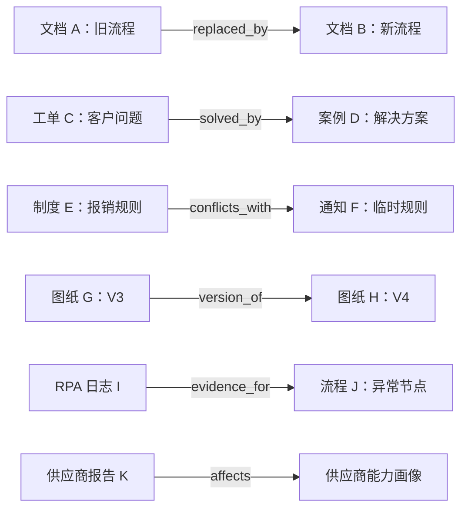

CrossDocumentRelation 表：

| 字段 | 说明 |
|---|---|
| cross_relation_id | 跨文档关系 ID |
| tenant_id | 租户 |
| relation_type | replaces、cites、conflicts_with、supports、supplements、derived_from、depends_on、evidence_for、solution_for |
| subject_document_id | 主体文档 |
| subject_chunk_id | 主体 Chunk，可为空 |
| subject_entity_id | 主体业务实体，可为空 |
| object_document_id | 客体文档 |
| object_chunk_id | 客体 Chunk，可为空 |
| object_entity_id | 客体业务实体，可为空 |
| direction | directed、undirected |
| evidence_count | 支撑证据数量 |
| confidence | 综合置信度 |
| governance_level | weak、candidate、confirmed、authoritative |
| visibility_policy | relation_only、authorized_endpoints_only、full_when_both_authorized |
| freshness_impact | none、mark_replaced、mark_conflicted、review_required |
| status | candidate、confirmed、rejected、deprecated |
| created_by | system、user、admin、business_event |
| confirmed_by | 确认人 |
| created_at | 创建时间 |
| updated_at | 更新时间 |

RelationEvidence 表：

| 字段 | 说明 |
|---|---|
| evidence_id | 证据 ID |
| cross_relation_id | 跨文档关系 ID |
| evidence_document_id | 证据文档 |
| evidence_chunk_id | 证据 Chunk |
| evidence_text | 支撑文本 |
| evidence_type | explicit_statement、same_identifier、version_pattern、business_event、user_confirmed、model_inferred |
| source_location | 页码、段落、表格区域、源系统链接 |
| confidence | 证据置信度 |
| permission_snapshot_id | 采集证据时的权限快照 |

跨文档关系类型建议：

| 关系 | 含义 | 使用场景 |
|---|---|---|
| replaces | A 替代 B | 新旧制度、新旧图纸、新旧流程 |
| version_of | A 是 B 的一个版本 | 图纸、SOP、报价模板 |
| cites | A 引用了 B | 制度引用规范、流程引用表单 |
| conflicts_with | A 与 B 冲突 | 两份规则结论不一致 |
| supports | A 支持 B 的结论 | 工单证明方案有效 |
| supplements | A 补充 B | 通知补充制度、案例补充流程 |
| derived_from | A 来源于 B | 官方答案来源于制度 |
| depends_on | A 依赖 B | 流程依赖表单、规则依赖审批 |
| evidence_for | A 是 B 的证据 | 运行日志证明流程问题 |
| solution_for | A 是 B 的解决方案 | 案例解决工单问题 |

跨文档关系的数据建模建议：

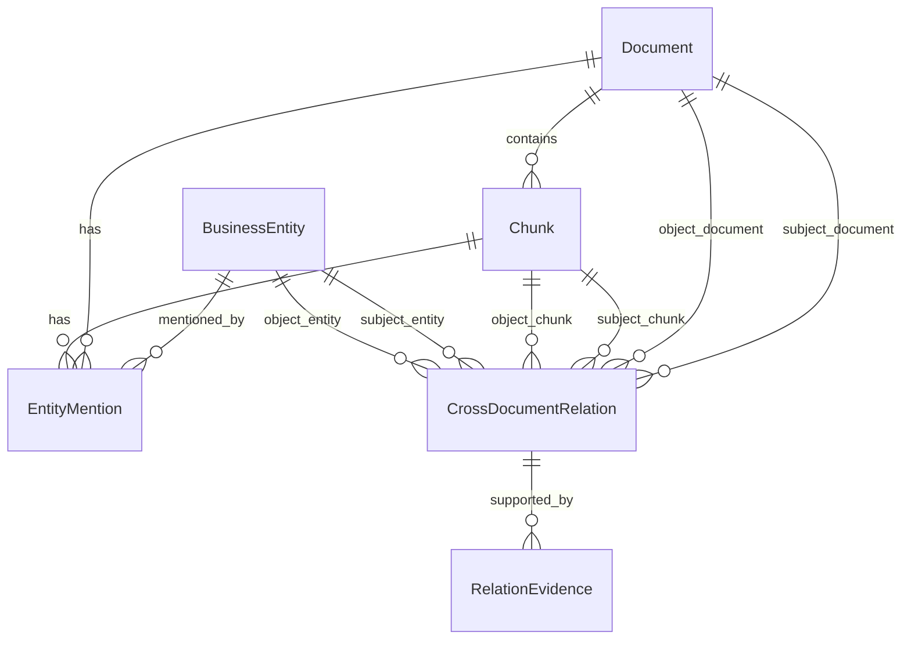

跨文档关系有一个很重要的权限原则：

> 系统内部可以保存跨文档关系，但用户只能看到自己有权限看到的关系端点和证据。不能因为“关系存在”而暴露无权限文档的标题、文件名、编号、摘要或业务字段。

可见性策略：

| 策略 | 说明 |
|---|---|
| relation_only | 只允许系统内部用于排序和状态判断，不对用户展示关系详情 |
| authorized_endpoints_only | 用户只能看到自己有权限的文档端点 |
| full_when_both_authorized | 只有两个端点和证据都授权时，才展示完整关系 |
| masked_target | 可提示“存在不可见替代版本或冲突资料”，但不显示敏感细节 |

### 9.5 本体抽取流水线

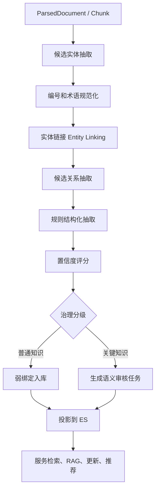

跨文档关系发现不是单文档抽取的附属动作，而是解析、本体、版本、新鲜度和业务事件共同驱动的独立流程。

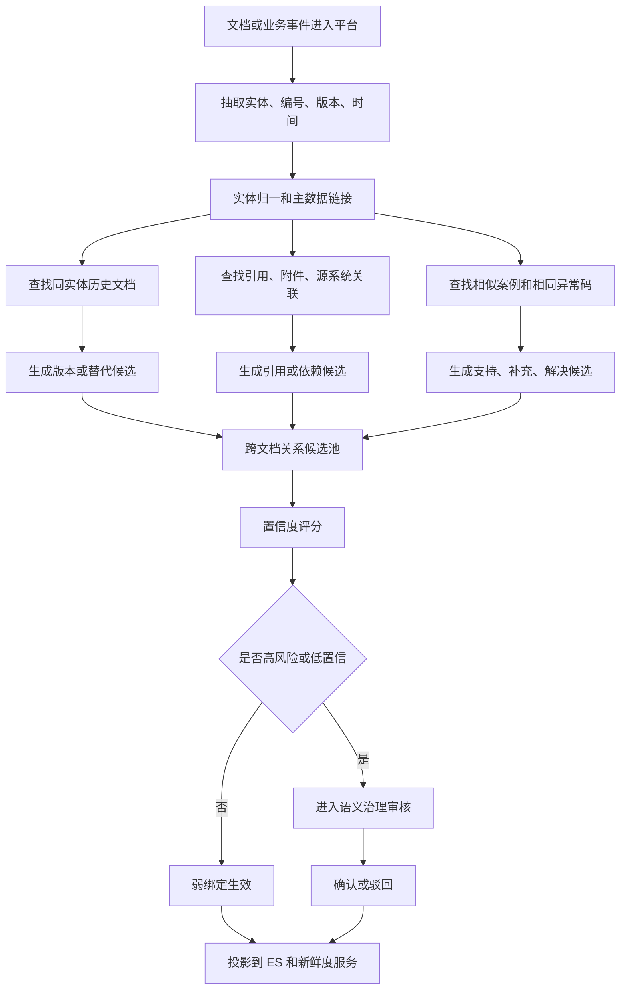

跨文档关系确认时序：

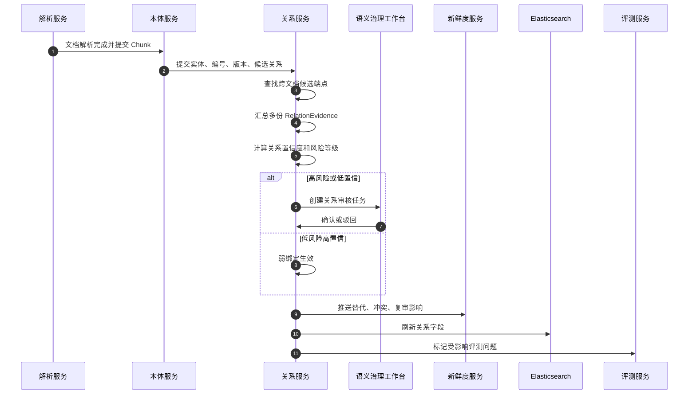

### 9.6 抽取方法组合

本体抽取不能只依赖大模型，应该组合多种方法。

| 方法 | 适用内容 | 优点 |
|---|---|---|
| 正则 | 图号、物料号、工单号、合同号、报价号 | 稳定、便宜 |
| 词典 | 部门、产品线、供应商、流程名称 | 可控 |
| 主数据匹配 | 客户、物料、产品、供应商 | 准确 |
| 文件名解析 | 编号、版本、日期、项目名 | 企业场景高价值 |
| 路径解析 | 部门、业务域、项目 | 可补元数据 |
| LLM 抽取 | 关系、规则、原因、解决方案 | 语义能力强 |
| 用户反馈 | 别名、错链、缺失关系 | 持续优化 |

### 9.7 本体抽取 JSON 输出规范

LLM 抽取必须输出结构化 JSON，不能直接把自然语言结果入库。

```json
{
  "entities": [
    {
      "type": "product_model",
      "raw_text": "X200-A",
      "normalized_text": "X200-A",
      "source_span": {"page": 2, "paragraph": 5},
      "confidence": 0.92
    }
  ],
  "relations": [
    {
      "type": "applies_to",
      "subject": {"type": "rule", "raw_text": "返修流程"},
      "object": {"type": "product_model", "raw_text": "X200-A"},
      "evidence_text": "本流程适用于 X200-A 系列产品返修",
      "confidence": 0.88
    }
  ],
  "rules": [
    {
      "rule_name": "返修审批规则",
      "applicable_scope": {
        "product_model": ["X200-A"],
        "department": ["售后服务部"]
      },
      "conditions": ["客户退回", "质检判定需返修"],
      "actions": ["创建返修工单", "主管审批"],
      "exceptions": ["保外维修需报价确认"],
      "effective_at": null,
      "expires_at": null,
      "confidence": 0.84
    }
  ]
}
```

### 9.8 置信度评分

实体或关系不能只保存一个模型置信度，建议综合评分。

```text
final_confidence =
  0.30 * extraction_confidence +
  0.25 * source_authority_score +
  0.15 * metadata_match_score +
  0.15 * cross_document_support_score +
  0.10 * parser_quality_score +
  0.05 * user_feedback_score
```

评分解释：

| 评分项 | 说明 |
|---|---|
| extraction_confidence | 抽取模型或规则置信度 |
| source_authority_score | 来源是否权威 |
| metadata_match_score | 是否与文件名、路径、源系统字段一致 |
| cross_document_support_score | 多文档是否互相支持 |
| parser_quality_score | 解析质量 |
| user_feedback_score | 用户确认或纠错 |

### 9.9 治理分级

本体治理不能一刀切。

| 等级 | 名称 | 处理方式 | 适用 |
|---|---|---|---|
| L0 | 不抽取 | 只做全文检索 | 临时、低价值内容 |
| L1 | 弱绑定 | 自动抽取，直接用于搜索增强 | 普通文档、一般经验 |
| L2 | 待确认 | 用于提示和候选，不作为权威依据 | 中等风险知识 |
| L3 | 已确认 | 可用于排序、RAG 约束、推荐 | 流程、案例、常见规则 |
| L4 | 权威控制 | 需要责任人、版本、复审、评测 | 图纸、制度、报价、财务、工艺、官方答案 |

### 9.10 强治理触发条件

系统自动判断哪些本体候选需要人工审核。

| 条件 | 处理 |
|---|---|
| 涉及价格、报价、合同金额 | 必须审核 |
| 涉及质量标准、工艺参数 | 必须审核 |
| 涉及图纸版本替代 | 必须审核 |
| 涉及财务、审计、合规 | 必须审核 |
| 涉及 HR 政策、薪酬、考勤 | 必须审核 |
| 置信度低于阈值 | 进入候选 |
| 与已有官方知识冲突 | 进入冲突任务 |
| 影响大量文档或高频问题 | 进入优先审核 |

### 9.11 本体如何提升检索

用户输入“X200 报错 E45 怎么处理”，系统要做：

1. 识别 `X200` 是产品型号。
2. 识别 `E45` 是异常代码。
3. 查询同义词和别名，例如 `X-200`、`X200A`。
4. 在 ES 中提升 product_model、exception_code 匹配。
5. 优先召回售后案例、生产异常、维修流程。
6. 过滤用户无权限知识。
7. 降低过期或低质量案例。

检索增强流程：

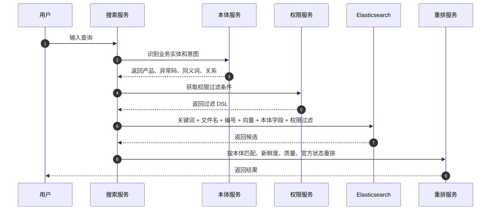

### 9.12 本体如何提升 RAG 准确率

RAG 不能只拿相似文本，还要检查语义适配。

在生成答案前，RAG 应检查：

| 检查项 | 示例 |
|---|---|
| 对象一致 | 用户问 X200，证据是否适用于 X200 |
| 版本一致 | 用户问 V3 图纸，证据是否是 V3 或当前版本 |
| 范围一致 | 用户问华东售后，证据是否适用于该区域 |
| 状态有效 | 证据是否有效、未过期、未被替代 |
| 规则适用 | 是否满足规则条件和例外条件 |
| 冲突存在 | 是否存在另一个权威来源给出不同结论 |

RAG 语义校验流程：

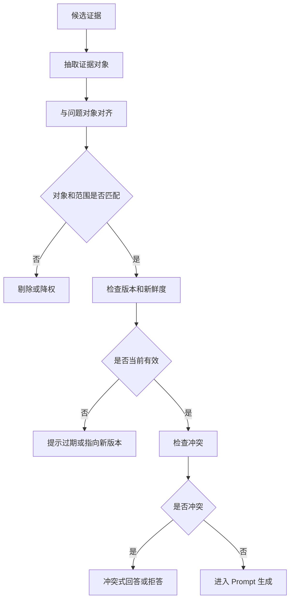

### 9.13 本体如何解决知识更新

本体关系中的 `replaces`、`version_of`、`depends_on`、`conflicts_with` 是知识更新的关键。

例如新图纸 D-100 V4 发布：

1. 系统识别 D-100 是图号，V4 是版本。
2. 查找旧版本 D-100 V1/V2/V3。
3. 建立 V4 `replaces` V3 的关系。
4. 把 V3 相关 Chunk 标为 replaced。
5. 触发 ES 更新。
6. 找出引用 V3 的官方答案、流程、案例。
7. 生成影响分析任务。
8. RAG 遇到 V3 证据时提示已有 V4。

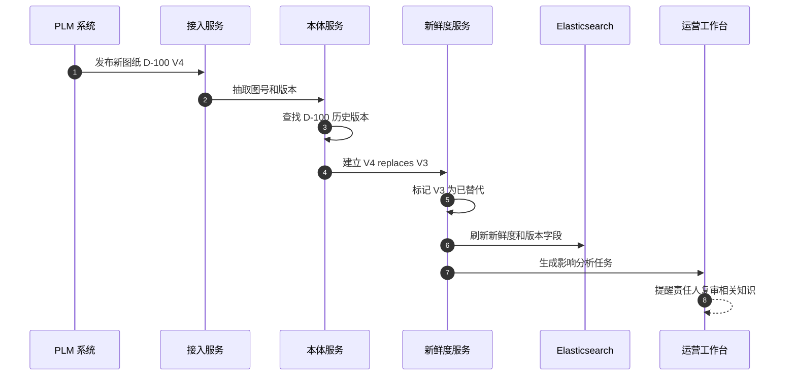

跨文档关系服务知识更新的完整链路：

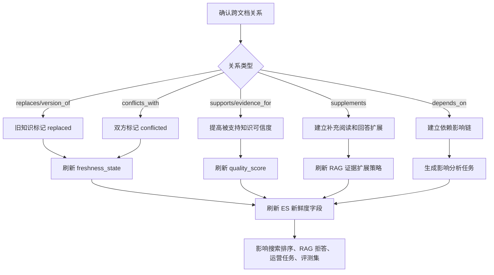

跨文档关系进入 RAG 时，不能简单把所有关联文档都塞进 Prompt。正确做法是分三步：

1. 只扩展用户有权限的关系端点。
2. 只选择与问题对象、时间、版本、适用范围一致的证据。
3. 对无权限但影响新鲜度的关系，只允许输出脱敏提示。

```mermaid
sequenceDiagram
  autonumber
  participant QA as 问答服务
  participant Auth as 权限服务
  participant Rel as 跨文档关系服务
  participant ES as Elasticsearch
  participant Fresh as 新鲜度服务
  participant LLM as 大模型

  QA->>ES: 权限过滤后召回初始证据
  ES-->>QA: 返回授权候选 Chunk
  QA->>Rel: 查询候选 Chunk 的跨文档关系
  Rel->>Auth: 校验关系端点和证据权限
  Auth-->>Rel: 返回可见端点和需脱敏端点
  Rel-->>QA: 返回授权关系、替代、冲突、补充证据
  QA->>Fresh: 校验替代和冲突状态
  Fresh-->>QA: 返回新鲜度约束
  QA->>QA: 证据充分性和权限安全检查
  QA->>LLM: 仅携带授权证据生成答案
  LLM-->>QA: 返回带引用答案
```

跨文档关系在答案里的呈现方式：

| 情况 | 答案处理 |
|---|---|
| 用户有两个端点权限 | 展示完整关系，例如“该流程已被新版流程替代”并引用两份资料 |
| 用户只有旧文档权限 | 可提示“当前资料可能不是最新版本”，但不展示新版标题和内容 |
| 用户只有新文档权限 | 直接使用新文档回答，不暴露旧文档细节 |
| 存在授权范围内冲突 | 展示冲突来源，避免给唯一结论 |
| 冲突一方无权限 | 提示存在需管理员复核的不一致，不展示无权限内容 |
| 支持证据很多 | 选择权威、最新、质量最高的证据进入 Prompt |

跨文档关系的权限安全流程：

```mermaid
flowchart TD
  A["关系服务发现 A 文档关联 B 文档"] --> B["用户请求搜索或问答"]
  B --> C["校验 A 文档权限"]
  B --> D["校验 B 文档权限"]
  B --> E["校验 RelationEvidence 权限"]
  C --> F{"A 是否可见"}
  D --> G{"B 是否可见"}
  E --> H{"证据是否可见"}
  F --> I["构造可见端点集合"]
  G --> I
  H --> I
  I --> J{"是否满足展示完整关系"}
  J -->|是| K["展示关系、端点和引用"]
  J -->|否| L["只做内部排序或脱敏提示"]
  L --> M["禁止泄露无权限文件名、标题、编号、摘要"]
```

跨文档关系对检索排序的影响：

```mermaid
flowchart LR
  A["初始检索候选"] --> B["读取跨文档关系"]
  B --> C["版本替代关系"]
  B --> D["冲突关系"]
  B --> E["支持证据关系"]
  B --> F["补充关系"]
  C --> G["旧版本降权，新版本升权"]
  D --> H["冲突知识降权或进入冲突提示"]
  E --> I["多证据支持知识升权"]
  F --> J["补充证据作为扩展阅读"]
  G --> K["最终排序"]
  H --> K
  I --> K
  J --> K
```

跨文档关系的影响分析接口和后台面板需要回答四个问题：

1. 这条关系影响哪些文档、官方答案、规则、案例和评测问题。
2. 哪些用户高频问题会受到影响。
3. 哪些 ES 索引字段需要刷新。
4. 哪些知识需要责任人复审。

```mermaid
flowchart TD
  A["关系变更"] --> B["找直接端点文档"]
  B --> C["找引用该文档的官方答案"]
  B --> D["找依赖该文档的规则"]
  B --> E["找命中过该文档的高频问题"]
  B --> F["找关联评测问题"]
  C --> G["生成复审任务"]
  D --> G
  E --> H["生成问答质量回归任务"]
  F --> H
  G --> I["刷新 ES 字段"]
  H --> I
  I --> J["更新知识健康度"]
```

### 9.14 本体治理后台面板

本体语义治理工作台不应该像传统知识图谱那样复杂，也不应成为重前端产品。它只承担高风险语义关系的审核、排障和影响分析。

#### 9.14.1 页面一：实体候选

功能：

1. 查看系统抽取的客户、产品、物料、图号、工单、供应商等。
2. 显示来源文档、出现次数、置信度、关联知识库。
3. 支持确认、驳回、合并、设为别名。
4. 支持批量处理高置信候选。

#### 9.14.2 页面二：关系候选

功能：

1. 查看 `适用于`、`替代`、`解决`、`导致`、`冲突` 等候选关系。
2. 显示证据文本。
3. 显示影响范围，例如会影响多少个问题和文档排序。
4. 支持确认、驳回、改关系类型。
5. 支持查看跨文档关系两端的文档、Chunk、业务实体和证据数量。
6. 支持在权限允许时打开关系图谱，展示“旧版本、新版本、引用、冲突、补充、支持证据”链路。

#### 9.14.3 页面三：术语和同义词

功能：

1. 管理业务术语。
2. 管理别名、缩写、旧称、英文名。
3. 支持从用户搜索无结果中发现同义词候选。

#### 9.14.4 页面四：规则结构化

功能：

1. 从制度和流程文档中抽取规则。
2. 编辑适用范围、生效期、例外条件、审批要求。
3. 发布为规则知识。
4. 关联官方答案。

#### 9.14.5 页面五：冲突与替代

功能：

1. 查看可能冲突的规则、流程、参数。
2. 查看可能被替代的旧版本。
3. 确认哪个是当前有效版本。
4. 触发新鲜度状态更新。

#### 9.14.6 面板六：跨文档关系图

功能：

1. 以某个文档、实体、图号、产品、流程或规则为中心，查看相关文档网络。
2. 区分替代、版本、引用、冲突、补充、支持、依赖等关系。
3. 节点显示文档状态、版本、新鲜度、责任人和密级。
4. 边显示关系类型、置信度、证据数量和治理状态。
5. 对用户无权限的节点做脱敏显示或完全隐藏。
6. 支持从关系图直接生成复审任务、冲突任务、索引刷新任务。

跨文档关系图调试视图示意：

```mermaid
flowchart TB
  Center["D-100 图纸 V4"]
  Old["D-100 图纸 V3"]
  SOP["装配 SOP 2026"]
  Case["售后案例 E45"]
  Report["生产异常报告"]
  Rule["质量检验规则"]
  Hidden["无权限节点"]

  Center -->|replaces| Old
  SOP -->|depends_on| Center
  Case -->|supports| SOP
  Report -->|supplements| Case
  Rule -->|conflicts_with| SOP
  Center -.->|masked| Hidden
```

### 9.15 本体 API

| API | 用途 |
|---|---|
| POST /ontology/extract | 对文档或 Chunk 进行本体抽取 |
| GET /ontology/entities | 查询实体 |
| POST /ontology/entities/merge | 合并实体 |
| POST /ontology/mentions/review | 审核实体提及 |
| GET /ontology/relations | 查询关系 |
| POST /ontology/relations/review | 审核关系 |
| GET /ontology/cross-document-relations | 查询跨文档关系 |
| POST /ontology/cross-document-relations/review | 审核跨文档关系 |
| GET /ontology/cross-document-relations/graph | 查询跨文档关系图 |
| GET /ontology/cross-document-relations/impact | 查询跨文档关系影响分析 |
| GET /ontology/synonyms | 查询同义词 |
| POST /ontology/query-understand | 查询理解 |
| POST /ontology/project-to-es | 将本体字段投影到 ES |
| GET /ontology/impact-analysis | 查看关系变更影响 |

### 9.16 本体后台任务

| 任务 | 触发 | 作用 |
|---|---|---|
| ontology_extract_job | 文档解析完成 | 抽取实体、关系、规则 |
| entity_linking_job | 抽取后 | 实体归一和链接 |
| relation_confidence_job | 每日 | 重算关系置信度 |
| synonym_mining_job | 每日 | 从搜索词、无结果词挖掘同义词 |
| ontology_es_projection_job | 本体变化 | 刷新 ES 字段 |
| conflict_detection_job | 每日/事件 | 发现规则、版本、参数冲突 |
| impact_analysis_job | 关系变化 | 分析受影响知识 |
| cross_document_relation_job | 文档解析完成/业务事件 | 发现替代、引用、冲突、补充、支持等跨文档关系 |
| relation_visibility_job | 权限变化/关系变化 | 计算跨文档关系在不同用户权限下的可见性 |

### 9.17 本体 ES 投影字段

| 字段 | 说明 |
|---|---|
| entities.customer_names | 客户名 |
| entities.customer_codes | 客户编码 |
| entities.product_models | 产品型号 |
| entities.material_codes | 物料编码 |
| entities.drawing_nos | 图号 |
| entities.work_order_nos | 工单号 |
| entities.supplier_names | 供应商 |
| ontology_relation_types | 关系类型 |
| applies_to_entities | 适用对象 |
| replaced_by | 替代版本 |
| conflicts_with | 冲突对象 |
| cross_doc_relation_ids | 跨文档关系 ID |
| cross_doc_relation_types | 跨文档关系类型 |
| related_document_ids | 授权范围内可见的关联文档 |
| relation_evidence_count | 关系证据数量 |
| relation_confidence | 关系综合置信度 |
| rule_scope | 规则适用范围 |
| ontology_confidence | 本体置信度 |
| ontology_governance_level | 治理等级 |

### 9.18 验收标准

1. 普通知识不需要人工标注也能自动抽取实体和关系。
2. 高风险知识会进入审核流程。
3. 用户搜索业务编号、产品、客户、异常码时，相关知识排名明显提升。
4. 本体关系变更后，ES 索引能刷新。
5. RAG 能利用对象、范围、版本、新鲜度判断证据是否适用。
6. 本体工作台显示来源证据，不允许无证据确认权威关系。
7. 跨文档替代、引用、冲突、支持、补充关系能被发现、审核、投影和解释。
8. 用户无权限访问关系端点时，系统不得泄露无权限文档的标题、文件名、编号、摘要或业务字段。

---

## 10. 模块八：知识新鲜度与生命周期

### 10.1 模块目标

知识库最难的不是把资料放进去，而是判断资料还是否有效。

新鲜度模块负责判断：

1. 资料是否过期。
2. 是否被新版本替代。
3. 是否与其他资料冲突。
4. 是否需要复审。
5. 是否应该继续参与 RAG。

### 10.2 新鲜度状态

| 状态 | 含义 | RAG 处理 |
|---|---|---|
| valid | 当前有效 | 可回答 |
| review_due | 到期需复审 | 可提示后回答或降权 |
| suspected_stale | 疑似过期 | 不作为权威答案 |
| expired | 已过期 | 默认不回答 |
| replaced | 已被替代 | 指向新版本 |
| conflicted | 存在冲突 | 冲突提示或拒答 |
| unknown | 状态未知 | 低置信度提示 |

### 10.3 过期判断信号

判断资料是否过期不能只看日期，应该组合多类信号。

| 信号 | 示例 |
|---|---|
| 显式失效时间 | 文件写明有效期到某日期 |
| 复审周期 | 制度每年复审，图纸每次版本变更复审 |
| 新版本发布 | D-100 V4 替代 V3 |
| 源系统状态 | PLM 图纸作废、工单关闭、流程停用 |
| 业务事件 | 组织调整、流程变更、价格调整 |
| 用户反馈 | 用户标记“这条已经不适用” |
| 冲突检测 | 两份资料对同一规则给出不同结论 |
| 低使用质量 | 高频负反馈、答案评测失败 |

### 10.4 新鲜度评分

```text
freshness_score =
  0.30 * explicit_validity_score +
  0.20 * source_status_score +
  0.15 * version_current_score +
  0.15 * review_cycle_score +
  0.10 * conflict_score +
  0.10 * feedback_score
```

### 10.5 生命周期状态机

```mermaid
stateDiagram-v2
  [*] --> Draft
  Draft --> Valid: 发布或同步成功
  Valid --> ReviewDue: 到达复审期
  ReviewDue --> Valid: 复审通过
  Valid --> SuspectedStale: 触发疑似过期信号
  SuspectedStale --> Valid: 确认仍有效
  SuspectedStale --> Expired: 确认失效
  Valid --> Replaced: 新版本替代
  ReviewDue --> Expired: 复审失败
  Valid --> Conflicted: 发现冲突
  Conflicted --> Valid: 冲突解决
  Expired --> Archived: 归档
  Replaced --> Archived: 归档旧版本
```

### 10.6 核心数据表

| 表 | 关键字段 | 说明 |
|---|---|---|
| freshness_policy | id, knowledge_type, review_interval_days, stale_action | 新鲜度策略 |
| freshness_signal | id, target_type, target_id, signal_type, signal_value, source, confidence | 新鲜度信号 |
| freshness_state | target_type, target_id, status, score, reason, updated_at | 当前状态 |
| replacement_relation | old_target_id, new_target_id, relation_confidence, confirmed_by | 替代关系 |
| review_task | id, target_type, target_id, owner_id, due_at, status | 复审任务 |
| conflict_record | id, target_a, target_b, conflict_type, evidence, status | 冲突记录 |

### 10.7 新鲜度处理流程

```mermaid
flowchart TD
  A["收到文档变化或业务事件"] --> B["采集新鲜度信号"]
  B --> C["识别业务对象和版本"]
  C --> D["查找相关知识"]
  D --> E["计算 freshness_score"]
  E --> F{"状态是否变化"}
  F -->|否| G["记录信号"]
  F -->|是| H["更新 freshness_state"]
  H --> I["刷新 ES 字段"]
  H --> J["生成复审或影响分析任务"]
  I --> K["影响检索和 RAG"]
```

### 10.8 新鲜度管理后台面板

知识新鲜度后台面板需要支持：

1. 按知识库查看过期、待复审、被替代、冲突数量。
2. 查看每条知识为什么被判定为过期或疑似过期。
3. 查看替代版本。
4. 批量确认仍有效。
5. 批量归档。
6. 将高风险知识发送给责任人复审。

### 10.9 验收标准

1. 有明确失效日期的知识到期后不能作为当前有效答案。
2. 新版本发布后，旧版本被标记为 replaced。
3. RAG 使用过期知识时必须提示或拒答。
4. 每个新鲜度状态都有原因和来源信号。

---

## 11. 模块九：Elasticsearch 统一检索

### 11.1 模块目标

Elasticsearch 是平台统一检索底座。

它要统一承载：

1. 全文检索。
2. 文件名检索。
3. 标题检索。
4. 业务编号检索。
5. 向量检索。
6. 本体字段检索。
7. 权限过滤。
8. 新鲜度过滤。
9. 质量排序。
10. 官方答案排序。

### 11.2 索引设计

建议至少建立 5 类索引。

| 索引 | 用途 |
|---|---|
| kb_document_v1 | 文档级检索 |
| kb_chunk_v1 | Chunk 级 RAG 召回 |
| kb_entity_v1 | 业务实体检索 |
| kb_official_answer_v1 | 官方答案检索 |
| kb_audit_pack_v1 | 证据包检索和审计 |

### 11.3 文档索引字段

| 字段 | 类型 | 说明 |
|---|---|---|
| tenant_id | keyword | 租户 |
| workspace_id | keyword | 工作区 |
| knowledge_base_id | keyword | 知识库 |
| document_id | keyword | 文档 |
| version_id | keyword | 版本 |
| file_name | text + keyword | 文件名 |
| file_name_ngram | text | 文件名模糊匹配 |
| title | text + keyword | 标题 |
| source_path | keyword | 来源路径 |
| source_system | keyword | 来源系统 |
| business_domain | keyword | 业务域 |
| identifiers | keyword[] | 业务编号集合 |
| security_level | keyword | 密级 |
| freshness_status | keyword | 新鲜度 |
| official_status | keyword | 官方状态 |
| quality_score | float | 质量分 |
| permission fields | keyword[] | 权限字段 |

### 11.4 Chunk 索引字段

| 字段 | 类型 | 说明 |
|---|---|---|
| chunk_id | keyword | Chunk |
| document_id | keyword | 文档 |
| chunk_text | text | Chunk 文本 |
| embedding | dense_vector | 向量 |
| heading_path | text + keyword | 标题路径 |
| page | integer | 页码 |
| table_region | keyword | 表格区域 |
| entity fields | keyword[] | 本体实体 |
| relation fields | keyword[] | 本体关系 |
| permission fields | keyword[] | 权限 |
| freshness fields | keyword | 新鲜度 |
| quality_score | float | 质量 |

### 11.5 查询意图分类

检索前先判断用户输入类型。

| 类型 | 示例 | 策略 |
|---|---|---|
| 文件名查询 | 返修流程2026.pdf | file_name 高权重 |
| 编号查询 | D-100-V4、MAT-001 | identifier 精确匹配 |
| 业务对象查询 | X200 故障 | 本体字段增强 |
| 流程规则查询 | 报销需要哪些材料 | 官方答案和规则优先 |
| 相似案例查询 | 类似 E45 的异常 | case + vector + ontology |
| 普通语义查询 | 如何处理客户退货 | 混合检索 |

### 11.6 混合检索公式

```text
final_score =
  0.20 * bm25_score +
  0.20 * vector_score +
  0.15 * identifier_score +
  0.10 * file_name_score +
  0.10 * ontology_match_score +
  0.10 * official_boost +
  0.05 * freshness_score +
  0.05 * quality_score +
  0.05 * feedback_score
```

编号类查询时应动态调整权重：

```text
identifier_query_score =
  0.45 * identifier_score +
  0.20 * file_name_score +
  0.10 * title_score +
  0.10 * bm25_score +
  0.05 * vector_score +
  0.05 * freshness_score +
  0.05 * quality_score
```

### 11.7 检索流程

```mermaid
flowchart TD
  A["用户输入"] --> B["查询清洗"]
  B --> C["意图分类"]
  C --> D["本体理解"]
  D --> E["生成关键词、编号、同义词、向量"]
  E --> F["获取权限过滤 DSL"]
  F --> G["构造 ES 混合查询"]
  G --> H["执行检索"]
  H --> I["新鲜度和质量重排"]
  I --> J["结果去重和聚合"]
  J --> K{"是否进入 RAG"}
  K -->|否| L["返回搜索结果"]
  K -->|是| M["交给可信 RAG"]
```

### 11.8 检索调试器

必须提供检索调试页面，帮助运营和研发定位“为什么搜不到”。

显示内容：

1. 原始查询。
2. 改写查询。
3. 意图分类结果。
4. 本体识别结果。
5. 权限过滤条件。
6. 命中的索引。
7. 各召回通道数量。
8. 候选分数。
9. 新鲜度降权原因。
10. 最终排序原因。

### 11.9 验收标准

1. 文件名和业务编号查询必须优先命中精确结果。
2. 所有查询必须带权限过滤。
3. 过期、低质量、非官方知识不能无条件排在前面。
4. 运维人员能通过调试器定位无结果原因。

---

## 12. 模块十：可信 RAG 问答

### 12.1 模块目标

可信 RAG 的目标不是“尽量回答”，而是“有证据就准确回答，证据不足就明确拒答或提示不确定”。

### 12.2 RAG 主流程

```mermaid
sequenceDiagram
  autonumber
  participant User as 用户
  participant QA as 问答服务
  participant Auth as 权限服务
  participant Ont as 本体服务
  participant ES as Elasticsearch
  participant Fresh as 新鲜度服务
  participant LLM as 大模型
  participant EP as Evidence Pack

  User->>QA: 提问
  QA->>Auth: 获取有效权限
  Auth-->>QA: 返回权限过滤条件
  QA->>Ont: 查询理解和实体识别
  Ont-->>QA: 返回意图、实体、同义词、关系
  QA->>ES: 权限感知混合检索
  ES-->>QA: 返回候选证据
  QA->>Fresh: 校验证据新鲜度和冲突
  Fresh-->>QA: 返回状态、替代、冲突
  QA->>QA: 证据充分性判断
  alt 证据不足
    QA->>EP: 保存拒答证据包
    QA-->>User: 拒答并说明原因
  else 证据充分
    QA->>LLM: 基于证据生成答案
    LLM-->>QA: 返回答案
    QA->>QA: 引用校验和事实一致性检查
    QA->>EP: 保存证据包
    QA-->>User: 返回答案和引用
  end
```

### 12.3 证据充分性判断

RAG 在调用模型前必须判断证据是否足够。

| 判断项 | 规则 |
|---|---|
| 相关性 | 证据必须与问题对象和意图匹配 |
| 权限 | 证据必须可用于 ask |
| 新鲜度 | 证据不能是 expired 或 replaced |
| 冲突 | 有冲突时不能给唯一确定结论 |
| 覆盖度 | 问题涉及多个条件时，证据要覆盖关键条件 |
| 来源权威 | 高风险问题优先官方或权威来源 |

### 12.4 回答模式

| 模式 | 用途 |
|---|---|
| 简洁回答 | 快速得到结论 |
| 详细回答 | 展开原因、步骤和依据 |
| 流程步骤 | SOP、办理流程 |
| 规则适用判断 | 是否适用某项制度或规则 |
| 故障排查 | 现象、原因、处理、验证 |
| 对比分析 | 多方案、多版本、多供应商对比 |
| 表格汇总 | 多条资料汇总成表 |
| 只检索不生成 | 高风险场景只返回证据 |

### 12.5 拒答规则

必须拒答或降级回答的场景：

| 场景 | 处理 |
|---|---|
| 无授权证据 | 拒答 |
| 证据不足 | 拒答并建议补充知识 |
| 只有过期证据 | 提示过期，不给当前结论 |
| 存在冲突证据 | 展示冲突，不强行下结论 |
| 问题要求越权信息 | 拒答 |
| 用户要求无依据推测 | 拒答 |
| 高风险决策缺少官方来源 | 只给参考证据，不给最终建议 |

### 12.6 Prompt 结构

Prompt 应该固定结构，不能把原文直接随意拼接。

```text
系统约束：
- 只能基于提供的证据回答。
- 不得使用未授权知识。
- 证据不足时必须拒答。
- 过期、替代、冲突证据必须显式说明。
- 每个关键结论必须引用证据编号。

用户问题：
{question}

问题理解：
{intent, entities, constraints}

证据：
{evidence list with id, text, source, version, freshness, permission}

回答要求：
{answer mode, language, format}
```

### 12.7 答案后校验

模型生成后必须做后校验。

| 校验 | 说明 |
|---|---|
| 引用覆盖 | 每个关键结论是否有引用 |
| 引用存在 | 引用 ID 是否真实存在 |
| 权限一致 | 引用是否仍有权限 |
| 新鲜度一致 | 是否遗漏过期提示 |
| 禁止泄露 | 是否输出未授权标题、编号、价格等 |
| 幻觉检查 | 是否出现证据中没有的结论 |

### 12.8 验收标准

1. 无证据问题必须拒答。
2. 越权知识不能进入 Prompt。
3. 答案中的关键事实都有引用。
4. 过期或冲突证据必须被提示。
5. 每次回答都有 Evidence Pack。

---

## 13. 模块十一：Evidence Pack 证据包

### 13.1 模块目标

Evidence Pack 是平台准确率和审计的核心凭证。

它记录一次问答、推荐或高价值检索到底用了什么证据、什么权限、什么版本、什么模型、为什么这样回答。

### 13.2 数据结构

| 字段 | 说明 |
|---|---|
| pack_id | 证据包 ID |
| tenant_id | 租户 |
| user_id | 用户 |
| session_id | 会话 |
| question | 原始问题 |
| rewritten_question | 改写问题 |
| intent | 意图 |
| entities | 本体识别结果 |
| permission_snapshot | 权限快照 |
| retrieval_query | ES 查询摘要 |
| evidence_items | 证据列表 |
| freshness_flags | 新鲜度标记 |
| conflict_flags | 冲突标记 |
| answer | 答案 |
| citations | 引用 |
| confidence | 置信度 |
| refusal_reason | 拒答原因 |
| model_info | 模型和参数 |
| created_at | 创建时间 |

### 13.3 证据项结构

```json
{
  "evidence_id": "ev_001",
  "document_id": "doc_001",
  "chunk_id": "chk_001",
  "source_name": "售后返修流程",
  "source_version": "v3",
  "page": 5,
  "paragraph": 12,
  "text_excerpt": "客户退回后需创建返修工单并提交主管审批",
  "freshness_status": "valid",
  "permission_action": "ask",
  "score": {
    "bm25": 8.1,
    "vector": 0.83,
    "ontology": 0.91,
    "final": 0.88
  }
}
```

### 13.4 Evidence Pack 调试详情

面向管理员和运营人员，证据包详情页要展示：

1. 用户问题。
2. 答案。
3. 引用证据。
4. 权限快照。
5. 检索链路。
6. 新鲜度状态。
7. 模型输出。
8. 用户反馈。
9. 错误诊断入口。

### 13.5 验收标准

1. 每次 RAG 回答必须生成证据包。
2. 证据包能复盘检索链路和引用来源。
3. 权限变化后，历史证据包仍保留当时快照。
4. 用户反馈必须绑定证据包。

---

## 14. 模块十二：官方答案与规则知识库

### 14.1 模块目标

官方答案用于高频、高风险、标准化问题。

规则知识库用于制度、流程、报价、质量、HR、财务等需要判断适用条件的知识。

### 14.2 官方答案模型

| 字段 | 说明 |
|---|---|
| official_answer_id | 官方答案 ID |
| question_patterns | 问法集合 |
| answer | 标准答案 |
| source_evidence | 来源证据 |
| applicable_scope | 适用范围 |
| effective_at | 生效时间 |
| expires_at | 失效时间 |
| owner_id | 责任人 |
| approval_status | 审批状态 |
| permission_scope | 权限范围 |
| version | 版本 |

### 14.3 官方答案流程

```mermaid
flowchart TD
  A["候选问题"] --> B["运营创建官方答案"]
  B --> C["绑定来源证据"]
  C --> D["设置适用范围和权限"]
  D --> E["提交审批"]
  E --> F{"审批是否通过"}
  F -->|否| G["退回修改"]
  F -->|是| H["发布"]
  H --> I["投影到 ES"]
  I --> J["RAG 优先命中"]
```

### 14.4 规则知识库设计

规则不应该只存自然语言，应尽量结构化。

示例：

```json
{
  "rule_name": "差旅报销材料规则",
  "conditions": {
    "expense_type": "travel",
    "amount_gte": 1000
  },
  "requirements": [
    "审批单",
    "发票",
    "行程单",
    "付款凭证"
  ],
  "exceptions": [
    "客户承担费用时需附客户确认邮件"
  ],
  "effective_at": "2026-01-01",
  "owner_department": "财务部"
}
```

### 14.5 验收标准

1. 官方答案必须有来源证据和审批记录。
2. 官方答案变更必须产生新版本。
3. 规则回答必须检查适用范围、时间和例外条件。
4. 过期官方答案不能作为当前答案。

---

## 15. 模块十三：评测与观测

### 15.1 模块目标

评测中心用于持续量化准确率，不能等用户投诉才发现问题。

### 15.2 评测对象

| 评测对象 | 指标 |
|---|---|
| 检索 | Recall@K、MRR、无结果率 |
| RAG 答案 | 正确率、引用覆盖率、拒答正确率 |
| 权限 | 越权召回率、权限误拒率 |
| 新鲜度 | 过期误用率、替代识别率 |
| 本体 | 实体抽取准确率、关系确认率 |
| 解析 | 解析成功率、引用定位成功率 |

### 15.3 黄金问题集

每个业务域都应维护黄金问题集。

字段：

| 字段 | 说明 |
|---|---|
| question | 问题 |
| expected_answer | 期望答案 |
| expected_evidence | 期望证据 |
| user_profile | 模拟用户权限 |
| business_domain | 业务域 |
| risk_level | 风险等级 |
| freshness_expectation | 是否应提示过期 |

### 15.4 评测流程

```mermaid
flowchart TD
  A["选择评测集"] --> B["选择模型和策略版本"]
  B --> C["按用户权限执行问题"]
  C --> D["收集检索结果和答案"]
  D --> E["自动评分"]
  E --> F["人工抽检"]
  F --> G["生成问题清单"]
  G --> H["定位知识、解析、检索、权限、本体、Prompt 问题"]
  H --> I["创建运营或研发任务"]
```

### 15.5 观测日志

需要记录：

1. 检索耗时。
2. ES 查询耗时。
3. RAG 生成耗时。
4. 召回数量。
5. 拒答率。
6. 用户反馈率。
7. 知识库命中分布。
8. 权限拦截数量。
9. 过期证据拦截数量。

### 15.6 验收标准

1. 每次上线新策略前能跑回归评测。
2. 能定位错误来自知识、解析、检索、本体、权限、模型还是 Prompt。
3. 权限越权召回率必须为 0。

---

## 16. 模块十四：知识运营工作台

### 16.1 模块目标

知识库不是一次建设完成，而是持续运营的产品。

运营工作台负责把系统发现的问题变成可处理任务。

### 16.2 任务类型

| 任务 | 来源 |
|---|---|
| 元数据缺失 | 元数据扫描 |
| 解析异常 | 解析服务 |
| 低质量 Chunk | 质量评分 |
| 用户反馈错误 | 问答反馈 |
| 过期复审 | 新鲜度服务 |
| 冲突处理 | 本体和新鲜度 |
| 权限异常 | 权限日志 |
| 无结果高频问题 | 搜索日志 |
| 官方答案候选 | 高频问答 |
| 本体候选审核 | 本体抽取 |

### 16.3 任务闭环

```mermaid
stateDiagram-v2
  [*] --> Open
  Open --> Assigned: 分派
  Assigned --> InProgress: 处理
  InProgress --> WaitingReview: 提交复核
  WaitingReview --> Done: 通过
  WaitingReview --> InProgress: 退回
  Open --> Ignored: 确认无需处理
  Done --> [*]
  Ignored --> [*]
```

### 16.4 运营管理后台面板

运营工作台基础面板：

1. 任务池：按类型、业务域、风险等级、责任人筛选。
2. 任务详情：显示问题、证据、影响范围、建议动作。
3. 批量处理：批量确认过期、批量补责任人、批量驳回低价值候选。
4. 运营指标：任务关闭率、平均处理时长、知识健康度。

### 16.5 验收标准

1. 用户反馈必须能转成任务。
2. 系统自动发现的问题必须能分派到责任人。
3. 任务处理后能触发 ES 刷新、状态更新或评测重跑。

---

## 17. 模块十五：业务过程沉淀与场景应用

### 17.1 模块目标

企业知识库最有价值的部分不是文件，而是业务过程中的经验。

平台要从工单、异常、项目、报价、审计、供应商、数字员工运行记录中自动沉淀知识。

### 17.2 沉淀标准结构

不同业务场景都应尽量沉淀成结构化经验。

#### 售后案例

| 字段 | 说明 |
|---|---|
| customer | 客户 |
| product_model | 产品 |
| symptom | 现象 |
| error_code | 错误码 |
| root_cause | 根因 |
| solution | 处理方案 |
| verification | 验证结果 |
| cost | 成本 |
| satisfaction | 客户反馈 |

#### 生产异常

| 字段 | 说明 |
|---|---|
| line | 产线 |
| material_code | 物料 |
| process_step | 工序 |
| abnormal_symptom | 异常现象 |
| root_cause | 根因 |
| temporary_action | 临时措施 |
| permanent_action | 永久措施 |
| responsible_dept | 责任部门 |

#### 报价经验

| 字段 | 说明 |
|---|---|
| customer | 客户 |
| product_model | 产品 |
| requirement | 需求 |
| cost_factors | 成本因素 |
| pricing_rule | 报价规则 |
| risk | 风险 |
| final_result | 成交或未成交 |

### 17.3 业务沉淀流程

```mermaid
flowchart TD
  A["业务事件结束"] --> B["拉取过程记录"]
  B --> C["识别是否有沉淀价值"]
  C --> D{"是否满足沉淀条件"}
  D -->|否| E["仅归档原始记录"]
  D -->|是| F["抽取结构化经验"]
  F --> G["关联业务对象和本体"]
  G --> H["生成候选知识"]
  H --> I{"是否高风险"}
  I -->|是| J["责任人审核"]
  I -->|否| K["弱绑定发布"]
  J --> L["发布为案例或规则"]
  K --> L
  L --> M["进入 ES 和 RAG"]
```

### 17.4 相似案例推荐

相似案例不能只靠向量。

推荐排序应综合：

1. 产品型号。
2. 错误码。
3. 工序。
4. 客户行业。
5. 根因。
6. 解决结果。
7. 新鲜度。
8. 质量评分。
9. 权限。

### 17.5 场景应用清单

| 场景 | 具体功能 |
|---|---|
| 售后 | 故障问答、相似案例、处理步骤、配件查询 |
| 研发 | 图纸检索、版本替代、设计经验、BOM 问答 |
| 生产 | 异常处置、工艺参数、质量问题复盘 |
| 报价 | 历史报价、规则解释、风险提示 |
| 财务审计 | 规则查询、审计案例、凭证要求 |
| HR 行政 | 流程入口、材料清单、政策问答 |
| 供应商 | 供应商能力、交期、质量案例、替代推荐 |
| 数字员工 | 流程说明、异常恢复、运行经验 |

### 17.6 验收标准

1. 关闭的工单或异常能生成候选知识。
2. 候选知识有结构化字段和来源证据。
3. 高风险沉淀必须审核后发布。
4. 相似推荐必须带权限过滤。

---

## 18. API、Agent 与 MCP 集成

### 18.1 模块目标

平台需要成为企业 AI 应用和业务系统的知识上下文服务。

对外提供：

1. 搜索 API。
2. 问答 API。
3. 证据 API。
4. 本体 API。
5. 知识更新事件。
6. Agent Context API。
7. MCP 工具接口。

### 18.2 核心 API

| API | 说明 |
|---|---|
| POST /search | 权限感知检索 |
| POST /answer | 可信 RAG 问答 |
| GET /evidence-packs/{id} | 查看证据包 |
| POST /documents | 上传或创建知识 |
| POST /datasources/{id}/sync | 触发同步 |
| POST /ontology/query-understand | 查询理解 |
| POST /freshness/evaluate | 评估新鲜度 |
| POST /agent/context | Agent 获取知识上下文 |
| POST /feedback | 用户反馈 |

### 18.3 Agent 调用规则

Agent 不允许以“超级用户”身份绕过权限。

必须满足：

1. Agent 身份有效。
2. Agent 有调用范围。
3. 被委托用户有对应知识权限。
4. 本次任务目的被记录。
5. 返回证据范围被审计。

```mermaid
sequenceDiagram
  autonumber
  participant Agent as Agent
  participant API as Knowledge API
  participant Auth as 权限服务
  participant ES as Elasticsearch
  participant EP as Evidence Pack

  Agent->>API: 请求知识上下文
  API->>Auth: 校验 Agent 身份
  API->>Auth: 校验被委托用户权限
  Auth-->>API: 返回交集权限范围
  API->>ES: 带权限过滤检索
  ES-->>API: 返回证据
  API->>EP: 记录 Agent 调用证据包
  API-->>Agent: 返回授权上下文
```

### 18.4 API 设计原则

后端接口必须按平台产品来设计，而不是按页面按钮临时拼接口。

| 原则 | 说明 |
|---|---|
| 资源模型清晰 | tenant、workspace、knowledge_base、document、chunk、answer、evidence_pack 都应是稳定资源 |
| 调用上下文显式 | 每次请求必须携带调用方、租户、用户或委托用户、业务目的 |
| 权限默认收敛 | API 默认不返回无权限内容，不能依赖调用方二次过滤 |
| 同步异步分离 | 搜索、问答可同步；接入、解析、重建索引、评测必须异步 |
| 错误可机器处理 | 错误码稳定，调用方能根据 code 做重试、降级或提示 |
| 证据标准输出 | 回答、推荐、高价值检索必须返回 evidence_pack_id |
| 版本可演进 | 使用 /v1、/v2 或 Accept-Version 管理接口版本 |
| 审计不可绕过 | 所有高价值 API 都要生成 audit_id 或 trace_id |

### 18.5 对外 API 分组

```mermaid
flowchart TB
  A["Knowledge API"] --> B["管理类 API"]
  A --> C["知识接入 API"]
  A --> D["检索 API"]
  A --> E["问答 API"]
  A --> F["证据 API"]
  A --> G["本体 API"]
  A --> H["新鲜度 API"]
  A --> I["运营评测 API"]
  A --> J["Agent Context API"]
  A --> K["Webhook API"]

  B --> B1["租户、工作区、知识库、权限"]
  C --> C1["文档上传、业务事件、同步任务"]
  D --> D1["搜索、相似案例、调试"]
  E --> E1["可信 RAG、流式回答、拒答"]
  F --> F1["证据包、引用、审计链路"]
  G --> G1["实体、关系、跨文档关系"]
  H --> H1["过期、替代、冲突、复审"]
  I --> I1["任务、反馈、评测集、评测运行"]
  J --> J1["Agent 授权上下文"]
  K --> K1["知识状态和任务事件推送"]
```

接口分组建议：

| 分组 | 主要调用方 | 核心接口 |
|---|---|---|
| Admin API | 管理后台、企业管控系统 | 租户、组织、角色、权限、配置 |
| Ingestion API | 业务系统、ETL、RPA | 文档上传、业务事件、同步任务 |
| Search API | 企业门户、业务系统、移动端 | 搜索、过滤、相似案例、调试 |
| Answer API | AI 助手、业务系统、客服系统 | 问答、流式问答、回答模式 |
| Evidence API | 审计、质检、运营、业务系统 | 证据包、引用、权限快照 |
| Ontology API | 运营后台、业务系统、Agent | 实体、关系、跨文档关系、影响分析 |
| Freshness API | 业务系统、运营后台 | 新鲜度评估、复审、替代、冲突 |
| Evaluation API | 研发、运营、发布系统 | 评测集、评测运行、回归结果 |
| Agent API | AI Agent、数字员工 | 上下文获取、工具调用、任务证据 |
| Webhook API | 外部系统 | 知识更新、任务、评测、权限事件 |

### 18.6 标准请求上下文

所有核心 API 都要统一请求上下文，避免各接口自己定义一套权限和审计字段。

```json
{
  "request_id": "req_20260708_0001",
  "tenant_id": "t_001",
  "workspace_id": "ws_after_sales",
  "caller": {
    "type": "application",
    "app_id": "app_crm",
    "api_key_id": "key_001"
  },
  "user_context": {
    "user_id": "u_001",
    "delegated": false,
    "org_units": ["bc_service", "dept_after_sales", "team_east"]
  },
  "purpose": "after_sales_troubleshooting",
  "locale": "zh-CN",
  "trace": {
    "trace_id": "trace_001",
    "source_system": "crm"
  }
}
```

必须统一处理：

| 字段 | 作用 |
|---|---|
| request_id | 幂等、排障、调用方日志对齐 |
| tenant_id | 租户隔离 |
| workspace_id | 工作区范围 |
| caller | 应用、API Key、Agent 或管理后台身份 |
| user_context | 用户或委托用户权限 |
| purpose | 业务目的，用于审计和策略控制 |
| trace_id | 全链路追踪 |

### 18.7 Search API 契约

请求示例：

```json
{
  "context": {
    "request_id": "req_search_001",
    "tenant_id": "t_001",
    "workspace_id": "ws_service",
    "caller": {"type": "application", "app_id": "app_crm"},
    "user_context": {"user_id": "u_001"},
    "purpose": "case_search"
  },
  "query": "X200 E45 怎么处理",
  "filters": {
    "knowledge_base_ids": ["kb_after_sales"],
    "freshness_status": ["valid", "review_due"],
    "business_domain": ["after_sales"]
  },
  "options": {
    "mode": "hybrid",
    "top_k": 10,
    "include_highlights": true,
    "include_debug": false
  }
}
```

响应示例：

```json
{
  "request_id": "req_search_001",
  "audit_id": "audit_001",
  "results": [
    {
      "document_id": "doc_001",
      "chunk_id": "chk_001",
      "title": "X200 E45 售后处理案例",
      "snippet": "E45 通常与传感器校准异常有关...",
      "score": 0.91,
      "score_detail": {
        "bm25": 0.72,
        "vector": 0.86,
        "identifier": 0.95,
        "ontology": 0.88,
        "freshness": 1.0
      },
      "freshness_status": "valid",
      "citations": [
        {"page": 2, "paragraph": 4}
      ]
    }
  ]
}
```

### 18.8 Answer API 契约

请求示例：

```json
{
  "context": {
    "request_id": "req_answer_001",
    "tenant_id": "t_001",
    "workspace_id": "ws_service",
    "caller": {"type": "agent", "agent_id": "agent_after_sales"},
    "user_context": {"user_id": "u_001", "delegated": true},
    "purpose": "customer_issue_resolution"
  },
  "question": "X200 出现 E45，现场工程师应该怎么处理？",
  "answer_mode": "troubleshooting",
  "constraints": {
    "require_citations": true,
    "allow_stale": false,
    "risk_level": "medium"
  },
  "options": {
    "stream": false,
    "return_evidence_pack": true
  }
}
```

响应示例：

```json
{
  "request_id": "req_answer_001",
  "audit_id": "audit_002",
  "evidence_pack_id": "ep_001",
  "answer_status": "answered",
  "confidence": 0.86,
  "answer": "建议先检查传感器连接状态，再执行校准流程...",
  "citations": [
    {
      "evidence_id": "ev_001",
      "document_id": "doc_001",
      "chunk_id": "chk_001",
      "title": "X200 E45 售后处理案例",
      "page": 2,
      "paragraph": 4
    }
  ],
  "risk_flags": [],
  "freshness_flags": []
}
```

拒答响应示例：

```json
{
  "request_id": "req_answer_002",
  "audit_id": "audit_003",
  "evidence_pack_id": "ep_002",
  "answer_status": "refused",
  "refusal_reason": "INSUFFICIENT_AUTHORIZED_EVIDENCE",
  "message": "当前权限范围内没有足够证据支持确定回答。",
  "suggested_actions": [
    "补充相关知识",
    "申请目标知识库权限",
    "联系知识责任人复核"
  ]
}
```

### 18.9 异步 Job 模型

以下接口不应同步等待完成：

1. 批量上传。
2. 数据源同步。
3. 文档解析。
4. 索引重建。
5. 本体抽取。
6. 新鲜度批量评估。
7. 评测运行。
8. 大规模权限刷新。

异步流程：

```mermaid
sequenceDiagram
  autonumber
  participant Client as 调用方
  participant API as API Gateway
  participant Job as Job Service
  participant Worker as Worker
  participant Webhook as Webhook Service

  Client->>API: POST /documents/batch
  API->>Job: 创建异步任务
  Job-->>API: 返回 job_id
  API-->>Client: 202 Accepted + job_id
  Worker->>Job: 拉取任务并执行
  Worker->>Job: 更新进度和结果
  alt 配置了 Webhook
    Job->>Webhook: 推送 job.completed 或 job.failed
    Webhook-->>Client: 发送回调
  else 未配置 Webhook
    Client->>API: GET /jobs/{job_id}
    API-->>Client: 返回状态和结果
  end
```

Job 状态：

```mermaid
stateDiagram-v2
  [*] --> Queued
  Queued --> Running
  Running --> Succeeded
  Running --> Failed
  Running --> PartiallySucceeded
  Queued --> Canceled
  Running --> Canceled
  Failed --> Retrying
  Retrying --> Running
  Succeeded --> [*]
  PartiallySucceeded --> [*]
  Canceled --> [*]
```

Job 响应结构：

```json
{
  "job_id": "job_001",
  "job_type": "document_parse",
  "status": "running",
  "progress": {
    "total": 100,
    "succeeded": 68,
    "failed": 2,
    "running": 3
  },
  "created_at": "2026-07-08T13:00:00+08:00",
  "updated_at": "2026-07-08T13:02:00+08:00"
}
```

### 18.10 Webhook 设计

Webhook 用于让外部系统及时知道知识状态变化。

推荐事件：

| 事件 | 含义 |
|---|---|
| document.ingested | 文档接入成功 |
| document.parse_failed | 文档解析失败 |
| document.indexed | 文档已进入索引 |
| knowledge.freshness_changed | 知识新鲜度变化 |
| ontology.cross_relation_confirmed | 跨文档关系确认 |
| review_task.created | 创建复审任务 |
| answer.feedback_created | 用户反馈创建 |
| eval.run_completed | 评测完成 |
| permission.policy_changed | 权限策略变化 |

Webhook 必须支持：

1. 签名校验。
2. 重试。
3. 去重。
4. 投递日志。
5. 订阅范围。
6. 失败告警。

### 18.11 错误码规范

错误响应统一结构：

```json
{
  "request_id": "req_001",
  "error": {
    "code": "PERMISSION_DENIED",
    "message": "当前调用方无权访问目标知识范围。",
    "details": {
      "action": "ask",
      "target_type": "knowledge_base"
    },
    "retryable": false
  }
}
```

核心错误码：

| code | 含义 | 是否可重试 |
|---|---|---|
| INVALID_ARGUMENT | 参数错误 | 否 |
| UNAUTHENTICATED | 未认证 | 否 |
| PERMISSION_DENIED | 无权限 | 否 |
| TENANT_MISMATCH | 租户不匹配 | 否 |
| RESOURCE_NOT_FOUND | 资源不存在或不可见 | 否 |
| RATE_LIMITED | 限流 | 是 |
| IDEMPOTENCY_CONFLICT | 幂等键冲突 | 否 |
| INDEX_NOT_READY | 索引未完成 | 是 |
| INSUFFICIENT_AUTHORIZED_EVIDENCE | 授权证据不足 | 否 |
| STALE_EVIDENCE_BLOCKED | 过期证据被拦截 | 否 |
| CONFLICTING_EVIDENCE | 存在冲突证据 | 否 |
| UPSTREAM_TIMEOUT | 上游超时 | 是 |
| INTERNAL_ERROR | 内部错误 | 是 |

### 18.12 幂等、限流与配额

| 能力 | 设计 |
|---|---|
| 幂等 | 写入类接口支持 Idempotency-Key |
| 限流 | 按 tenant、app、user、API 分层限流 |
| 配额 | 文档数量、存储量、Token、QPS、并发 Job |
| 降级 | 模型超时时返回搜索结果或拒答 |
| 熔断 | 数据源、模型、ES 异常时保护核心服务 |
| 重试 | 只允许对明确 retryable 的错误自动重试 |

### 18.13 SDK 与 OpenAPI

为了让别人更容易接入，平台应该提供：

1. OpenAPI 3.1 文档。
2. Postman 或 Apifox 示例集合。
3. Java SDK。
4. Python SDK。
5. JavaScript/TypeScript SDK。
6. Agent 工具调用示例。
7. Webhook 签名校验示例。
8. 沙箱环境。

SDK 最小能力：

```mermaid
flowchart LR
  A["SDK"] --> B["认证"]
  A --> C["Search"]
  A --> D["Answer"]
  A --> E["Upload"]
  A --> F["Job Polling"]
  A --> G["Evidence"]
  A --> H["Webhook Verify"]
```

### 18.14 最小管理后台

页面只保留后端平台运行所需的基础能力，不做复杂业务前端。

| 页面 | 目的 | 优先级 |
|---|---|---|
| API Key 管理 | 创建、禁用、查看调用范围 | P0 |
| 租户/工作区配置 | 基础空间和策略配置 | P0 |
| 知识库管理 | 创建知识库、绑定策略、查看状态 | P0 |
| 数据源管理 | 配置接入、查看同步状态 | P0 |
| 权限中心 | 配置策略、临时授权、权限模拟 | P0 |
| API 调试台 | 测试 Search/Answer/Ingestion API | P0 |
| Job 中心 | 查看异步任务进度和失败原因 | P0 |
| 审计日志 | 查看访问、问答、权限、Agent 审计 | P1 |
| Evidence Pack 详情 | 排查回答质量和证据链 | P1 |
| 新鲜度/运营任务 | 处理过期、冲突、反馈、复审 | P1 |
| 本体治理 | 只处理高风险关系、跨文档关系、术语 | P1 |
| 评测中心 | 回归评测和准确率看板 | P1 |

### 18.15 验收标准

1. API 和 Agent 都不能绕过权限。
2. Agent 调用必须有审计。
3. 外部系统能获取引用和证据包 ID。
4. 核心接口有统一 request_id、audit_id、trace_id。
5. 写入类接口支持幂等。
6. 异步任务有标准 Job 状态和查询接口。
7. Search API、Answer API、Evidence API 有稳定响应结构。
8. 调用方能根据错误码做重试、降级或提示。
9. Webhook 支持签名、重试、去重和投递日志。
10. 页面只作为管理、调试、审计和运营工具存在。

---

## 19. 安全与非功能设计

### 19.1 安全要求

| 要求 | 说明 |
|---|---|
| 租户隔离 | 不同企业数据隔离 |
| 权限先行 | 检索前过滤 |
| Prompt 防注入 | 文档内容不能覆盖系统规则 |
| 敏感字段脱敏 | 价格、客户、合同、财务等按策略脱敏 |
| 审计完整 | 登录、搜索、问答、下载、权限变更都审计 |
| 数据加密 | 存储和传输加密 |
| API 限流 | 防止滥用 |
| 模型调用隔离 | 不向外部模型泄露敏感数据，按部署策略执行 |

### 19.2 性能目标

| 指标 | 目标 |
|---|---|
| 搜索 P95 | 2 秒内 |
| 普通问答 P95 | 8 秒内 |
| 大文档解析 | 异步任务 |
| 权限变更生效 | 配置 SLA 内 |
| 索引延迟 | 增量分钟级 |
| 可用性 | 99.9% 起步 |

### 19.3 准确率目标

| 指标 | 目标 |
|---|---|
| 权限越权召回率 | 0 |
| 引用覆盖率 | 高风险问题 100% |
| 无证据拒答正确率 | 持续提升 |
| 过期资料误用率 | 接近 0 |
| 文件名精确命中率 | 高优先级保障 |
| 编号精确命中率 | 高优先级保障 |

---

## 20. 建设路线图

### 20.1 V0.1：后端 API 底座可用

范围：

1. API Gateway、API Key、租户上下文、统一 request_id。
2. Admin API：知识库、数据源、基础权限配置。
3. Ingestion API：文件上传、业务事件提交、异步 Job。
4. 基础解析和切片。
5. ES 文档和 Chunk 索引。
6. Search API：文件名、标题、全文、编号检索。
7. Evidence API：基础引用和证据查询。
8. 最小管理后台：API 调试、Job 查看、权限配置。

### 20.2 V0.2：可信问答 API

范围：

1. 公司级权限。
2. 权限过滤检索。
3. Answer API：可信 RAG、拒答、引用、风险标记。
4. Evidence Pack。
5. 审计日志。
6. 统一错误码、幂等、限流。
7. Feedback API。
8. Webhook 基础事件。

### 20.3 V0.3：准确率可运营 API

范围：

1. 新鲜度状态。
2. 官方答案。
3. 规则知识库。
4. Freshness API。
5. Evaluation API。
6. 知识运营 API。
7. 运营后台只保留任务处理和评测看板。

### 20.4 V0.4：业务过程沉淀与本体 API

范围：

1. 工单沉淀。
2. 生产异常沉淀。
3. 报价和供应商经验沉淀。
4. 相似案例推荐。
5. Ontology API：实体、关系、跨文档关系。
6. 业务事件驱动知识更新。
7. 跨文档关系影响分析。

### 20.5 V1.0：企业知识智能 API 平台

范围：

1. 稳定 AI 语义本体。
2. Agent Context API。
3. MCP 工具接口。
4. 多业务系统事件驱动更新。
5. 端到端准确率运营。
6. OpenAPI、SDK、沙箱、Webhook 完整对接能力。

---

## 21. 研发开工拆分建议

### 21.1 后端服务拆分

| 服务 | 第一阶段优先级 |
|---|---|
| Identity & Org Service | P0 |
| Permission Service | P0 |
| Knowledge Base Service | P0 |
| Ingestion Service | P0 |
| Parser Service | P0 |
| Indexing Service | P0 |
| Search Service | P0 |
| RAG Service | P0 |
| Evidence Pack Service | P1 |
| Freshness Service | P1 |
| Ontology Service | P1 |
| Evaluation Service | P1 |
| Operations Service | P1 |
| Agent API Service | P2 |

### 21.2 最小管理后台页面拆分

页面不作为核心产品形态，只用于让平台能配置、调试、审计和运营。

| 页面 | 第一阶段优先级 | 设计边界 |
|---|---|---|
| API Key 管理 | P0 | 创建、禁用、授权范围、调用统计 |
| API 调试台 | P0 | 测试 Search、Answer、Upload、Job 查询 |
| 知识库管理 | P0 | 创建知识库、绑定策略、查看状态 |
| 数据源管理 | P0 | 配置连接器、触发同步、查看失败 |
| 权限中心 | P0 | 权限策略、临时授权、权限模拟器 |
| Job 中心 | P0 | 查看解析、索引、评测等异步任务 |
| 审计日志 | P1 | 搜索、问答、下载、权限、Agent 调用审计 |
| Evidence Pack 详情 | P1 | 排查答案证据链 |
| 新鲜度和运营任务 | P1 | 处理过期、冲突、复审、反馈 |
| 本体治理 | P1 | 只处理高风险实体、关系、跨文档关系 |
| 评测中心 | P1 | 回归评测和准确率看板 |
| 简单问答演示页 | P2 | 仅用于内部测试，不作为主产品 |

### 21.3 第一阶段最小闭环

第一阶段不要贪多，但必须保证“后端 API 底座正确”。

最小闭环：

```mermaid
flowchart LR
  A["调用 Admin API 创建知识库"] --> B["调用 Permission API 配置权限"]
  B --> C["调用 Ingestion API 上传文档"]
  C --> D["返回 Job ID"]
  D --> E["后台解析切片"]
  E --> F["写入 ES"]
  F --> G["调用 Search API"]
  G --> H["调用 Answer API"]
  H --> I["返回答案、引用、Evidence Pack ID"]
  I --> J["调用 Feedback API"]
```

第一阶段必须做扎实：

1. API Gateway、API Key、租户上下文。
2. Admin API、Ingestion API、Search API、Answer API、Evidence API。
3. 文件名检索。
4. 业务编号检索。
5. 权限过滤。
6. 引用定位。
7. 拒答机制。
8. 基础 Evidence Pack。
9. Job 模型。
10. 统一错误码、request_id、audit_id、trace_id。

### 21.4 第二阶段增强闭环

```mermaid
flowchart LR
  A["业务系统调用 Feedback API"] --> B["生成运营任务"]
  B --> C["运营后台处理知识、权限、本体或新鲜度"]
  C --> D["触发索引刷新 Job"]
  D --> E["触发评测回归 Job"]
  E --> F["通过 Webhook 通知调用方"]
  F --> B
```

---

## 22. 关键验收清单

平台上线前必须通过以下验收。

### 22.1 权限验收

1. 不同事业中心用户看到不同结果。
2. 不同部门用户看到不同结果。
3. 不同团队用户看到不同结果。
4. 自定义人员集合授权生效。
5. 临时授权到期失效。
6. Agent 调用不越权。
7. 未授权文件名和敏感元数据不泄露。

### 22.2 检索验收

1. 文件名精确查询可命中。
2. 文件名模糊查询可命中。
3. 图号、物料号、工单号、报价号可命中。
4. 普通语义问题可召回相关 Chunk。
5. 过期、低质量知识排序降低。

### 22.3 RAG 验收

1. 无证据拒答。
2. 证据不足拒答。
3. 越权问题拒答。
4. 过期知识提示。
5. 冲突知识提示。
6. 每个关键结论有引用。

### 22.4 本体验收

1. 自动抽取客户、产品、物料、图号、工单、供应商。
2. 能识别适用、替代、版本、解决、导致、冲突关系。
3. 普通知识弱绑定，不增加管理员负担。
4. 高风险关系进入审核。
5. 本体字段能提升搜索和 RAG 准确率。

### 22.5 新鲜度验收

1. 到期知识自动进入复审。
2. 新版本能替代旧版本。
3. 过期知识不能被当成当前权威答案。
4. 新鲜度状态有原因可解释。

---

## 23. 模块级接口、事件与任务清单

这一章用于把前面 15 个模块进一步转成研发可以拆任务的清单。

### 23.1 模块接口清单

| 模块 | 接口 | 方法 | 说明 |
|---|---|---|---|
| 平台与组织基础 | /tenants | POST/GET | 创建和查询租户 |
| 平台与组织基础 | /workspaces | POST/GET | 创建和查询工作区 |
| 平台与组织基础 | /org-units/sync | POST | 触发组织同步 |
| 平台与组织基础 | /users/{id}/context | GET | 查询用户组织、角色、团队上下文 |
| 平台与组织基础 | /platform-configs | GET/PUT | 查询和更新平台配置 |
| 权限中心 | /permissions/policies | POST/GET/PUT | 权限策略管理 |
| 权限中心 | /permissions/effective | POST | 计算用户有效权限 |
| 权限中心 | /permissions/simulate | POST | 权限模拟器 |
| 权限中心 | /person-sets | POST/GET/PUT | 自定义人员集合 |
| 权限中心 | /temporary-authorizations | POST/GET/PUT | 临时授权申请、审批、撤销 |
| 知识库管理 | /knowledge-bases | POST/GET/PUT | 知识库管理 |
| 知识库管理 | /knowledge-bases/{id}/policies | GET/PUT | 绑定解析、权限、新鲜度、本体策略 |
| 知识库管理 | /knowledge-bases/{id}/health | GET | 知识库健康度 |
| 数据源接入 | /data-sources | POST/GET/PUT | 数据源管理 |
| 数据源接入 | /data-sources/{id}/test | POST | 连接测试 |
| 数据源接入 | /data-sources/{id}/sync | POST | 触发同步 |
| 数据源接入 | /sync-jobs/{id} | GET | 查看同步批次 |
| 解析切片 | /documents | POST/GET | 上传和查询文档 |
| 解析切片 | /documents/{id}/versions | GET | 查询版本 |
| 解析切片 | /documents/{id}/parse | POST | 触发解析 |
| 解析切片 | /chunks | GET | 查询 Chunk |
| 元数据质量 | /metadata/issues | GET | 元数据问题列表 |
| 元数据质量 | /metadata/patch | POST | 补全元数据 |
| 元数据质量 | /quality/recalculate | POST | 重算质量分 |
| AI 语义本体 | /ontology/extract | POST | 本体抽取 |
| AI 语义本体 | /ontology/entities | GET | 实体查询 |
| AI 语义本体 | /ontology/entities/merge | POST | 实体合并 |
| AI 语义本体 | /ontology/relations | GET | 关系查询 |
| AI 语义本体 | /ontology/relations/review | POST | 关系审核 |
| AI 语义本体 | /ontology/cross-document-relations | GET | 跨文档关系查询 |
| AI 语义本体 | /ontology/cross-document-relations/graph | GET | 跨文档关系图查询 |
| AI 语义本体 | /ontology/cross-document-relations/review | POST | 跨文档关系审核 |
| AI 语义本体 | /ontology/cross-document-relations/impact | GET | 跨文档影响分析 |
| AI 语义本体 | /ontology/query-understand | POST | 查询理解 |
| AI 语义本体 | /ontology/impact-analysis | GET | 影响分析 |
| 新鲜度 | /freshness/evaluate | POST | 评估新鲜度 |
| 新鲜度 | /freshness/states | GET | 查询状态 |
| 新鲜度 | /freshness/review-tasks | GET/PUT | 复审任务 |
| 新鲜度 | /freshness/replacements | POST | 确认替代关系 |
| ES 检索 | /search | POST | 权限感知搜索 |
| ES 检索 | /search/debug | POST | 检索调试 |
| ES 检索 | /indexes/rebuild | POST | 重建索引 |
| 可信 RAG | /answer | POST | 问答 |
| 可信 RAG | /answer/stream | POST | 流式问答 |
| 可信 RAG | /answer/modes | GET | 查询回答模式 |
| Evidence Pack | /evidence-packs/{id} | GET | 查看证据包 |
| Evidence Pack | /evidence-packs/{id}/feedback | POST | 对证据包反馈 |
| 官方答案规则库 | /official-answers | POST/GET/PUT | 官方答案管理 |
| 官方答案规则库 | /official-answers/{id}/publish | POST | 发布官方答案 |
| 官方答案规则库 | /rules | POST/GET/PUT | 规则知识管理 |
| 评测观测 | /eval/datasets | POST/GET | 黄金问题集 |
| 评测观测 | /eval/runs | POST/GET | 发起和查看评测 |
| 评测观测 | /observability/traces | GET | 查询链路追踪 |
| 知识运营 | /ops/tasks | POST/GET/PUT | 运营任务 |
| 知识运营 | /ops/tasks/batch | POST | 批量处理 |
| 业务沉淀 | /business-deposition/candidates | GET | 候选沉淀知识 |
| 业务沉淀 | /business-deposition/publish | POST | 发布沉淀知识 |
| API/Agent | /agent/context | POST | Agent 获取知识上下文 |
| API/Agent | /api-keys | POST/GET/PUT | API Key 管理 |

### 23.2 平台事件清单

平台建议使用事件驱动，避免各模块直接强耦合。

| 事件 | 触发方 | 消费方 | 用途 |
|---|---|---|---|
| org.unit.changed | 组织服务 | 权限服务、审计服务 | 组织变更后刷新权限 |
| user.status.changed | 用户服务 | 权限服务、审计服务 | 离职、禁用后权限失效 |
| permission.policy.changed | 权限服务 | 索引服务、Evidence Pack 服务 | 刷新权限投影 |
| knowledge_base.created | 知识库服务 | 权限服务、审计服务 | 初始化默认策略 |
| document.uploaded | 文档服务 | 解析服务 | 启动解析 |
| document.parsed | 解析服务 | 本体服务、索引服务、质量服务 | 进入本体抽取和索引 |
| document.parse_failed | 解析服务 | 运营服务 | 生成解析异常任务 |
| chunk.created | 解析服务 | 索引服务、本体服务 | Chunk 入索引 |
| metadata.low_quality | 质量服务 | 运营服务 | 元数据补全任务 |
| ontology.entity.extracted | 本体服务 | 本体服务、索引服务 | 实体链接和 ES 投影 |
| ontology.relation.confirmed | 本体服务 | 新鲜度服务、索引服务、评测服务 | 替代、冲突、适用关系生效 |
| ontology.cross_relation.detected | 本体服务 | 运营服务、关系服务 | 发现跨文档关系候选 |
| ontology.cross_relation.confirmed | 本体服务 | 新鲜度服务、索引服务、RAG 服务、评测服务 | 跨文档关系确认生效 |
| ontology.cross_relation.visibility_changed | 权限服务 | 搜索服务、RAG 服务 | 权限变化后刷新关系可见性 |
| freshness.state.changed | 新鲜度服务 | 索引服务、RAG 服务、运营服务 | 影响检索和回答 |
| index.document.updated | 索引服务 | 搜索服务 | 索引刷新 |
| answer.generated | RAG 服务 | Evidence Pack 服务、观测服务 | 保存证据和链路 |
| answer.refused | RAG 服务 | Evidence Pack 服务、运营服务 | 分析拒答原因 |
| feedback.created | 用户反馈 | 运营服务、评测服务 | 创建诊断任务 |
| official_answer.published | 官方答案服务 | 索引服务、评测服务 | 官方知识生效 |
| eval.run.completed | 评测服务 | 运营服务、研发看板 | 生成问题清单 |
| business.case.closed | 业务连接器 | 业务沉淀服务 | 生成候选经验 |
| agent.context.requested | Agent API | 审计服务、Evidence Pack 服务 | Agent 调用审计 |

### 23.3 后台任务清单

| 任务 | 所属模块 | 触发方式 | 说明 |
|---|---|---|---|
| org_sync_job | 平台基础 | 定时/手动 | 同步组织和用户 |
| permission_cache_refresh_job | 权限中心 | 事件/定时 | 刷新有效权限缓存 |
| permission_projection_job | 权限中心 | 策略变化 | 刷新 ES 权限字段 |
| data_source_sync_job | 数据接入 | 定时/手动/webhook | 同步数据源 |
| source_permission_capture_job | 数据接入 | 同步时 | 捕获源权限 |
| document_parse_job | 解析切片 | 文档上传 | 解析原文 |
| chunk_build_job | 解析切片 | 解析完成 | 生成 Chunk |
| parse_quality_job | 元数据质量 | 解析完成 | 评分解析质量 |
| metadata_completeness_job | 元数据质量 | 定时 | 检查元数据缺失 |
| ontology_extract_job | AI 本体 | Chunk 创建 | 抽取实体、关系、规则 |
| entity_linking_job | AI 本体 | 抽取后 | 实体归一和链接 |
| relation_confidence_job | AI 本体 | 定时 | 重算关系置信度 |
| cross_document_relation_job | AI 本体 | 文档解析完成/业务事件 | 发现跨文档替代、引用、冲突、补充、支持关系 |
| relation_visibility_job | AI 本体/权限中心 | 权限变化/关系变化 | 计算关系端点和证据可见性 |
| synonym_mining_job | AI 本体 | 定时 | 从搜索日志挖掘同义词 |
| ontology_projection_job | AI 本体 | 本体变化 | 投影本体字段到 ES |
| freshness_evaluate_job | 新鲜度 | 事件/定时 | 计算新鲜度状态 |
| review_due_job | 新鲜度 | 每日 | 生成复审任务 |
| conflict_detection_job | 新鲜度/本体 | 定时/事件 | 发现冲突 |
| index_build_job | ES 检索 | 文档变化 | 建索引 |
| index_repair_job | ES 检索 | 定时 | 修复索引不一致 |
| rag_trace_compaction_job | RAG | 定时 | 压缩问答链路日志 |
| evidence_retention_job | Evidence Pack | 定时 | 证据包归档和保留 |
| official_answer_review_job | 官方答案 | 定时 | 官方答案复审 |
| eval_regression_job | 评测 | 发布前/定时 | 回归评测 |
| ops_task_routing_job | 运营 | 任务创建 | 分派责任人 |
| business_deposition_job | 业务沉淀 | 业务事件 | 抽取候选经验 |
| agent_audit_job | API/Agent | Agent 调用 | Agent 调用审计 |

### 23.4 端到端测试用例清单

| 用例 | 步骤 | 期望 |
|---|---|---|
| 文件名检索 | 上传文件后用部分文件名搜索 | 命中授权文件并高亮文件名 |
| 编号检索 | 搜索图号或物料号 | 精确编号结果排名靠前 |
| 权限隔离 | 两个不同部门用户搜索同一关键词 | 只能看到各自授权结果 |
| 自定义人员授权 | 将用户加入项目人员集合 | 用户可搜索该集合授权知识 |
| 临时授权到期 | 创建短期授权并等待到期 | 到期后搜索和问答不可访问 |
| RAG 有证据回答 | 提问有充分证据的问题 | 答案有引用和 Evidence Pack |
| RAG 无证据拒答 | 提问知识库不存在的问题 | 拒答并记录原因 |
| 过期知识拦截 | 将文档标记 expired 后提问 | 不作为当前答案 |
| 替代版本提示 | 新版本替代旧版本后提问 | 指向新版本 |
| 冲突知识提示 | 两个规则冲突时提问 | 展示冲突，不强行定论 |
| 本体实体增强 | 提问产品型号和异常码 | 命中相关案例和流程 |
| 本体关系影响更新 | 确认 replaces 关系 | 旧版本 ES 字段和新鲜度更新 |
| 跨文档替代 | 新制度替代旧制度 | 旧制度降权并提示新版本 |
| 跨文档冲突 | 两份授权规则结论不同 | RAG 展示冲突并避免单一结论 |
| 跨文档权限脱敏 | 关系一端用户无权限 | 不泄露无权限文档标题、文件名、编号和摘要 |
| 跨文档支持证据 | 多个工单支持同一方案 | 方案排序提升并展示可见证据 |
| 官方答案优先 | 高频问题配置官方答案 | 官方答案优先返回 |
| 用户反馈闭环 | 标记答案错误 | 生成运营任务并关联证据包 |
| Agent 权限 | Agent 代用户请求上下文 | 取 Agent 与用户权限交集 |

### 23.5 第一批数据表优先级

| 优先级 | 表 |
|---|---|
| P0 | tenant、workspace、org_unit、user_account、user_org_binding |
| P0 | knowledge_base、document、document_version、chunk |
| P0 | permission_policy、permission_subject、temporary_authorization |
| P0 | data_source、source_record、sync_job |
| P0 | es_index_task、audit_log |
| P0 | answer_session、evidence_pack、evidence_item |
| P1 | metadata_issue、quality_score_record |
| P1 | ontology_type、business_entity、entity_mention、business_relation |
| P1 | cross_document_relation、relation_evidence |
| P1 | freshness_policy、freshness_signal、freshness_state、review_task |
| P1 | official_answer、rule_knowledge |
| P1 | eval_dataset、eval_question、eval_run、eval_result |
| P1 | ops_task、feedback |
| P2 | agent_identity、api_key_identity、agent_audit |
| P2 | business_case、deposition_candidate |

### 23.6 第一批 ES 索引优先级

| 优先级 | 索引 | 说明 |
|---|---|---|
| P0 | kb_document_v1 | 文档级检索 |
| P0 | kb_chunk_v1 | RAG 证据召回 |
| P1 | kb_official_answer_v1 | 官方答案检索 |
| P1 | kb_entity_v1 | 本体实体检索 |
| P1 | kb_eval_trace_v1 | 评测和调试 |
| P2 | kb_business_case_v1 | 业务案例推荐 |

### 23.7 本体模块开发拆解

本体模块建议拆成 8 个研发子任务，避免一开始做成庞大复杂系统。

| 子任务 | 内容 | 阶段 |
|---|---|---|
| 本体类型字典 | 内置客户、产品、物料、图号、工单、供应商等类型 | V0.3 |
| 编号抽取器 | 用正则和文件名解析抽取业务编号 | V0.3 |
| 实体提及入库 | 保存 raw_text、normalized_text、source_location、confidence | V0.3 |
| ES 本体字段投影 | 将实体字段写入 kb_document_v1 和 kb_chunk_v1 | V0.3 |
| 查询理解 | 搜索前识别实体、编号、同义词和意图 | V0.4 |
| 关系候选抽取 | 抽取 applies_to、replaces、version_of、solves、conflicts_with | V0.4 |
| 跨文档关系发现 | 发现文档之间的替代、引用、冲突、补充、支持、依赖关系 | V0.4 |
| 跨文档权限可见性 | 控制关系两端和证据在不同用户权限下的展示方式 | V0.4 |
| 语义治理工作台 | 审核实体、关系、同义词、冲突、规则 | V0.4 |
| 本体影响分析 | 关系变化后刷新新鲜度、索引和评测目标 | V1.0 |

本体模块第一版不要追求完整知识图谱，先把三个高价值点做扎实：

1. 业务编号识别。
2. 实体字段增强检索。
3. 替代、版本、冲突关系服务知识更新。

---

## 24. 总结

这套设计的关键不是功能堆叠，而是建立企业级知识平台的底层闭环：

1. 知识进得来。
2. 权限控得住。
3. 文件名和业务编号搜得准。
4. 语义本体让系统懂业务对象和关系。
5. RAG 只基于授权、有效、可追溯证据回答。
6. 过期、冲突、替代知识能被识别。
7. 用户反馈和评测能反向驱动知识更新。
8. 业务过程能自动沉淀为经验。
9. API 和 Agent 能安全复用知识底座。

其中 AI 语义本体不应该被设计成重型人工维护项目，而应该作为轻量语义层嵌入全链路：

> 在接入时自动抽取，在检索时增强匹配，在 RAG 时校验证据，在更新时判断替代和冲突，在运营时只把高价值、高风险、低置信度问题交给人处理。

这样才能同时满足三个目标：

1. 好用。
2. 准确。
3. 可长期运营。
