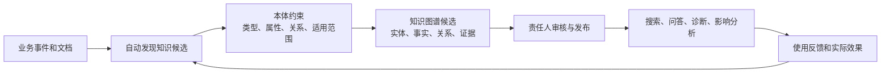
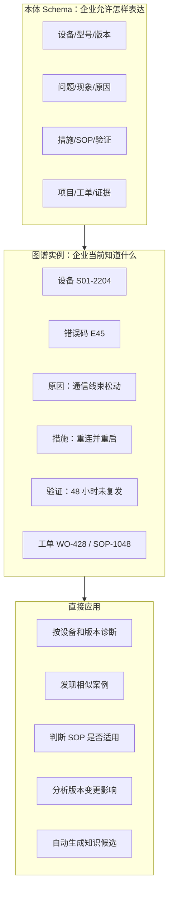
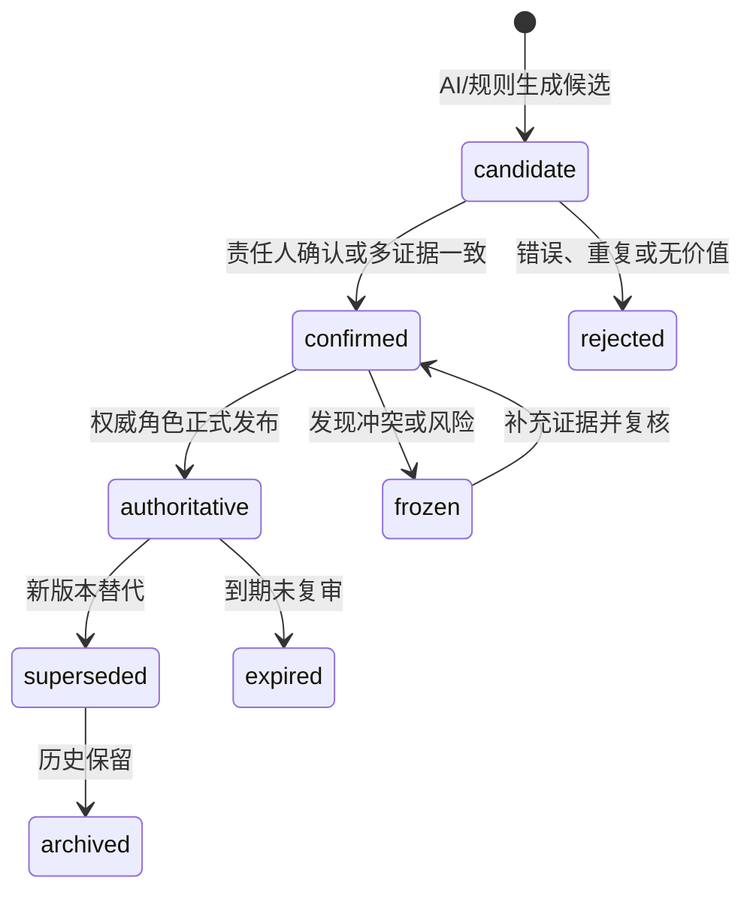
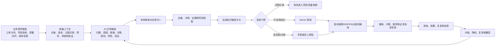
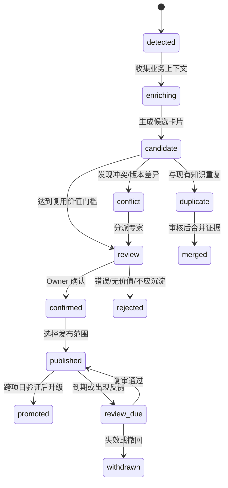
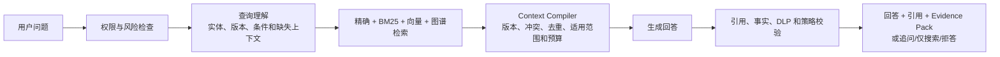
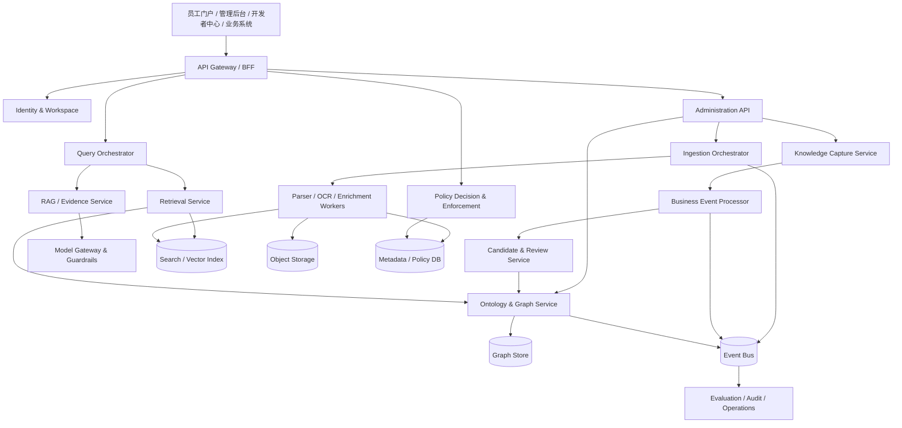

<a id="top"></a>

# KnowAxis 企业级知识智能平台最终功能设计

> 文档定位：面向业务负责人、产品、研发、知识管理员和实施团队的产品功能总览与详细设计  
> 阅读方式：先看第 1 章功能全景图；通过目录直接跳转到对应功能详解  
> 重点能力：AI 本体与知识图谱一体化、业务知识自动沉淀、可信检索问答、知识治理  
> 文档状态：产品功能、业务实例、实施设计和验收标准最终整合版

<a id="document-toc"></a>

## 文档目录（点击跳转）

1. [设计结论](#design-conclusion)
2. [一图看懂 KnowAxis](#platform-overview)
   - [功能导航](#function-navigation)
   - [两项核心能力如何配合](#core-capability-loop)
3. [平台定位与目标用户](#positioning-users)
4. [完整功能地图](#function-map)
5. [AI 本体与知识图谱一体化设计](#ontology-graph)
   - [用实例理解本体和知识图谱](#ontology-example)
   - [E45 故障诊断完整实例](#e45-example)
   - [本体/图谱产品页面](#ontology-pages)
6. [业务知识自动沉淀设计](#knowledge-capture)
   - [自动沉淀闭环](#capture-loop)
   - [售后工单 WO-428 完整实例](#wo428-example)
   - [项目验收知识包](#project-package-example)
   - [质量异常闭环](#quality-example)
7. [其他平台功能详解](#platform-functions)
8. [三条核心用户旅程](#user-journeys)
9. [产品信息架构](#product-ia)
10. [分阶段实施方案](#implementation-roadmap)
11. [验收指标](#acceptance-metrics)
12. [关键产品边界](#product-boundaries)
13. [技术实现与接口摘要](#technical-summary)
14. [术语表](#glossary)
15. [最终验收清单](#final-checklist)

---

<a id="design-conclusion"></a>

## 0. 设计结论

KnowAxis 不是一个“上传文件后聊天”的工具，而是一套企业知识生产、组织、验证、使用和持续更新的平台。

平台围绕两项核心能力形成差异化：

1. **AI 本体与知识图谱一体化**：把企业中的设备、产品、物料、项目、问题、措施、版本、规则和证据组织成统一、可追溯的业务语义网络。
2. **业务知识自动沉淀**：从工单、项目、质量、制造、售后等业务过程自动发现可复用经验，生成知识候选，经过责任人确认后发布和持续演进。

本体负责定义“企业知识应该怎样表达”，知识图谱负责保存“企业当前知道的具体事实”，AI 负责从文档和业务事件中生成候选，业务责任人负责确认哪些内容可以成为正式知识。

[返回目录](#document-toc)

---

<a id="platform-overview"></a>

## 1. 一图看懂 KnowAxis

```mermaid
flowchart TB
    U[使用者\n一线工程师、项目经理、质量专家、知识管理员、业务系统]

    subgraph APP[业务应用层]
        A1[统一搜索与可信问答]
        A2[故障诊断与相似案例]
        A3[项目知识包]
        A4[变更影响分析]
        A5[官方答案与规则判断]
        A6[API / SDK / 受控 Agent]
    end

    subgraph CORE[知识智能核心]
        C1[AI 本体与知识图谱\n定义语义、归一实体、组织关系、分析影响]
        C2[业务知识自动沉淀\n监听业务事件、生成候选、审核发布、复用升级]
        C3[可信检索与回答\n混合检索、上下文编译、引用、拒答]
        C4[证据与版本中心\n来源定位、有效期、替代关系、冲突和撤回]
    end

    subgraph BASE[知识数据与控制底座]
        B1[数据源与连接器]
        B2[解析、切片与多模态]
        B3[身份、权限与数据治理]
        B4[模型网关与安全防护]
    end

    subgraph OPS[运营保障]
        O1[评测与发布门禁]
        O2[知识运营与责任人]
        O3[质量、成本、SLO 与审计]
    end

    U --> APP
    BASE --> CORE
    C1 <--> C2
    C1 --> C3
    C4 --> C1
    C4 --> C2
    C4 --> C3
    CORE --> APP
    OPS --> CORE
    OPS --> BASE
```



<a id="function-navigation"></a>

### 1.1 功能导航

| 想了解什么 | 先看 | 进一步了解 |
|---|---|---|
| 本体到底是什么，和知识图谱是什么关系 | [第 4.1 节：用具体例子理解](#ontology-example) | [第 4 章完整设计](#ontology-graph) |
| 本体和图谱如何解决实际业务问题 | [第 4.4 节：E45 故障诊断](#e45-example) | [第 4.7 节：产品页面](#ontology-pages) |
| 业务经验如何自动变成知识 | [第 5.2 节：沉淀闭环](#capture-loop) | [第 5 章完整设计](#knowledge-capture) |
| 想看完整的自动沉淀实例 | [第 5.5 节：售后工单实例](#wo428-example) | [项目验收实例](#project-package-example) / [质量异常实例](#quality-example) |
| 搜索和问答为什么可信 | [第 6.4 节](#trusted-search-answer) | [技术实现与接口摘要](#technical-summary) |
| 如何分期实施 | [第 9 章](#implementation-roadmap) | [第 10 章验收指标](#acceptance-metrics) |

<a id="core-capability-loop"></a>

### 1.2 两项核心能力如何配合



本体和知识图谱解决“知识如何组织和关联”，自动沉淀解决“新知识从哪里来、怎样持续更新”。二者必须共同建设，否则会出现两种问题：只有图谱没有沉淀，知识很快过期；只有自动抽取没有本体，候选知识无法归一、冲突和复用。

[返回目录](#document-toc)

---

<a id="positioning-users"></a>

## 2. 平台定位与目标用户

### 2.1 产品定位

KnowAxis 位于企业业务系统和 AI 应用之间：

- PLM、ERP、MES、QMS、CRM、项目系统和工单系统继续负责业务交易和主数据。
- KnowAxis 负责跨系统知识关联、语义归一、证据组织、经验沉淀、可信检索问答和知识治理。
- AI 应用、业务系统和 Agent 通过统一 Knowledge API 使用经过权限、版本和证据控制的知识。

### 2.2 核心用户

| 用户 | 日常问题 | KnowAxis 提供的能力 |
|---|---|---|
| 一线工程师/售后 | 当前设备出现问题应该怎么处理 | 当前版本 SOP、相似案例、验证过的措施和引用 |
| 项目经理 | 项目结束后哪些经验值得复用 | 自动项目知识包、决策、问题、措施、风险和候选资产 |
| 质量/工艺专家 | 某问题是否重复发生，措施是否真正有效 | 问题、物料、供应商、措施、验证和复发关系 |
| 知识 Owner | 哪些候选值得发布，哪些知识已过期 | 候选审核、冲突处理、发布、复审和影响分析 |
| 本体管理员/Steward | 不同系统对同一对象叫法不一致 | 类型、属性、关系、别名、约束和实体归一 |
| 管理者 | 知识平台是否产生业务价值 | 重复问题下降、处理时长、知识复用、质量和风险指标 |
| 业务系统/Agent | 如何安全使用企业知识 | 权限过滤的 Search、Evidence、Graph 和 Answer API |

[返回目录](#document-toc)

---

<a id="function-map"></a>

## 3. 完整功能地图

| 一级模块 | 主要功能 | 直接价值 | 详解 |
|---|---|---|---|
| 工作空间与权限中心 | 组织、成员、角色、策略、ACL、撤权、审计 | 确保用户只能使用其当前有权访问的知识 | [第 6.1 节](#identity-permission) |
| 数据接入中心 | 连接器、同步、范围预览、增量、删除、失败重试 | 稳定接入企业数据并保持与源系统一致 | [第 6.2 节](#data-ingestion) |
| 内容与版本中心 | 原文、解析、切片、版本、替代、有效期、来源定位 | 区分当前知识和历史知识 | [第 6.3 节](#content-version-evidence) |
| **AI 本体与知识图谱** | 本体建模、AI 抽取、实体归一、关系审核、图谱发布、影响分析 | 让知识可关联、可推理、可判断适用范围 | [第 4 章](#ontology-graph) |
| **业务知识自动沉淀** | 业务事件监听、候选生成、知识卡片、审核、发布、推广和复用度量 | 把工作过程持续变成企业资产 | [第 5 章](#knowledge-capture) |
| 统一检索与可信问答 | 精确检索、混合召回、图谱增强、引用、冲突和拒答 | 快速获得当前适用且有依据的答案 | [第 6.4 节](#trusted-search-answer) |
| 官方答案与规则中心 | 条件、例外、适用范围、审批、发布和复审 | 控制制度、工艺、质量、安全等高风险结论 | [第 6.5 节](#official-rules) |
| 知识运营中心 | 缺口、反馈、过期、冲突、责任人、任务和复用效果 | 让知识持续维护而非一次性建设 | [第 6.6 节](#knowledge-operations) |
| 开放平台 | API、SDK、Webhook、只读 MCP、应用配额 | 将知识能力嵌入业务系统和 AI 应用 | [第 6.7 节](#open-platform) |

[返回目录](#document-toc)

---

<a id="ontology-graph"></a>

## 4. AI 本体与知识图谱一体化设计

<a id="ontology-example"></a>

### 4.1 先用具体例子理解本体和知识图谱

假设企业中出现以下售后记录：

> STACK-01 设备，程序版本 V6.2，出现错误码 E45。工程师检查后发现 BMS 通信线束松动，重新连接线束并断电 30 秒后重启，节点 0x31 恢复在线，连续运行 48 小时未复发。

系统要理解这段记录，必须先知道企业允许使用哪些业务概念：

| 本体定义的类型 | 示例实例 | 关键属性 |
|---|---|---|
| `EquipmentModel` 设备型号 | STACK-01 | 产品系列、支持版本 |
| `Equipment` 设备实例 | S01-2204 | 序列号、客户项目、当前版本 |
| `ProgramVersion` 程序版本 | V6.2 | 生效时间、替代版本、适用型号 |
| `ErrorCode` 错误码 | E45 | 所属系统、严重等级 |
| `Symptom` 现象 | 节点 0x31 离线 | 检测位置、发生时间 |
| `Cause` 原因 | BMS 通信线束松动 | 原因状态、确认方式 |
| `Action` 处理措施 | 重新连接线束并重启 | 前置条件、安全要求 |
| `Verification` 验证结果 | 连续运行 48 小时未复发 | 验证时长、结论 |
| `WorkOrder` 工单 | WO-428 | 项目、处理人、关闭时间 |
| `Procedure` SOP | SOP-1048 V6.2 | 版本、适用范围、审批状态 |

本体还规定这些类型之间允许存在什么关系：

```text
Equipment --instance_of--> EquipmentModel
Equipment --runs_version--> ProgramVersion
Equipment --reported--> ErrorCode
ErrorCode --has_symptom--> Symptom
ErrorCode --suspected_cause/confirmed_cause--> Cause
Action --solves--> ErrorCode
Action --verified_by--> Verification
WorkOrder --performed--> Action
Procedure --applies_to--> EquipmentModel + ProgramVersion
ProgramVersion V6.2 --supersedes--> ProgramVersion V6.1
```

因此：

- **本体**类似企业知识的“统一业务语言和规则说明书”，定义类型、属性、关系和约束。
- **知识图谱**是按这套语言保存的“实际业务事实网络”，里面放 STACK-01、E45、WO-428 等具体实例。
- **AI**负责从文档、工单和用户描述中发现这些实例和关系候选，但不能绕过本体约束和审批直接宣布它们是正式事实。

这里所说的“AI 本体”是 **AI 辅助的本体建模、映射和维护能力**，不是由模型自动决定企业语义，也不是哲学意义上的本体论讨论。

#### 与目录、标签和数据字典的区别

| 能力 | 回答的问题 | 以 E45 场景为例 | 不能独立解决的问题 |
|---|---|---|---|
| 文件目录 | 资料放在哪里 | “售后资料/STACK-01/故障手册” | 不知道不同文件中的对象是否相同 |
| 标签 | 资料属于哪一类 | 标签“故障”“BMS”“V6” | 不定义标签之间的关系和约束 |
| 数据字典 | 字段叫什么、是什么类型 | `error_code` 是字符串，`version` 是版本号 | 不表达 E45 适用于哪个型号和版本 |
| 本体 | 企业对象是什么意思、允许怎样关联 | ErrorCode 可关联 EquipmentModel、Cause、Action、Verification | 本身不保存 WO-428 等具体业务事实 |
| 知识图谱 | 企业当前有哪些具体对象和关系事实 | E45、STACK-01、WO-428、SOP-1048 及其关系 | 如果没有本体约束，容易出现重复、歧义和错误关系 |

### 4.2 从本体到业务应用



### 4.3 一体化功能组成

| 功能 | 用户操作 | 系统处理 | 结果 |
|---|---|---|---|
| 本体模型管理 | 新建/调整类型、属性、关系和约束 | 兼容性检查、样本迁移预演、影响分析 | 可发布的 Schema 版本 |
| AI 语义发现 | 上传资料或选择业务事件 | 识别业务对象、编号、版本、关系和规则候选 | `ExtractionPlan` |
| 映射配置 | 把源字段或文本概念映射到本体 | 别名匹配、字段转换、单位标准化 | 可复用映射模板 |
| 实体归一 | 审核疑似同一对象 | 业务键、别名、属性和关系联合匹配 | `CanonicalEntity` |
| 关系与事实审核 | 确认、修正或拒绝关系 | 约束、证据、权限、版本和风险检查 | 候选/确认/权威事实 |
| 图谱版本发布 | 查看变更集并审批 | 回归测试、影响计算、生成不可变提交 | `GraphCommit` 和当前投影 |
| 图谱探索 | 按实体查看上下游关系 | 权限投影、路径查询、证据加载 | 关系图、时间线和证据 |
| 影响分析 | 选择设备、版本、物料、图纸或规则 | 沿依赖、适用、替代关系计算 | 受影响对象和责任人列表 |
| 语义查询服务 | 搜索或调用 API | 查询理解、实体链接、适用性判断 | 检索过滤和可信回答上下文 |

<a id="e45-example"></a>

### 4.4 详细应用实例：STACK-01 E45 故障诊断

#### 场景输入

工程师输入：

> 设备 S01-2310，STACK-01，程序 V6.2，出现 E45，节点 0x31 离线，应该怎么处理？

#### 系统处理

| 步骤 | 系统动作 | 本体/图谱发挥的作用 |
|---|---|---|
| 1. 理解问题 | 识别设备号、型号、程序版本、错误码和现象 | 本体规定这些对象的类型与字段 |
| 2. 实体链接 | 将 S01-2310 关联到 STACK-01，并确认当前程序为 V6.2 | 图谱提供设备、型号和版本关系 |
| 3. 适用性判断 | 排除只适用于 V6.1 的旧处理方法 | `applies_to` 和 `supersedes` 关系参与过滤 |
| 4. 证据检索 | 查找 SOP-1048 V6.2 和相似工单 WO-428 | 图谱关系帮助跨文档找到相关证据 |
| 5. 冲突处理 | 发现旧版建议“更换主控板”已被替代 | 版本和矛盾关系阻止旧结论进入答案 |
| 6. 生成回答 | 输出处理步骤、适用范围、安全前提和引用 | 回答中的每个关键结论绑定证据 |

#### 返回结果示例

> 对 STACK-01 / V6.2 的 E45，先检查 BMS 通信接插件和线束。确认连接后执行断电挂牌，等待 30 秒再重启控制器，并在诊断页确认节点 0x31 在线。若节点仍离线，再升级至售后工程师处理。旧版 V6.1 的“直接更换主控板”方案已被替代，不适用于当前设备。

引用：

1. SOP-1048 V6.2，第 37 页，步骤 2-5。
2. 工单 WO-428，处理记录与连续运行 48 小时验证结果。

#### 没有本体/图谱时会怎样

| 问题 | 只有向量检索 | 使用本体和知识图谱 |
|---|---|---|
| E45 属于哪个设备和版本 | 依赖文本是否刚好出现关键词 | 通过设备、型号、版本关系确定 |
| V6.1 和 V6.2 哪个有效 | 可能同时召回 | 根据替代和有效期过滤 |
| 工单经验与 SOP 如何关联 | 只按文本相似度 | 根据错误码、措施和验证关系关联 |
| 是否可以认为线束是根因 | 容易把相似描述当事实 | 区分 suspected/confirmed，并检查验证证据 |
| 图纸或程序变更影响哪些知识 | 很难跨文档计算 | 沿 depends_on/applies_to/affects 路径计算 |

### 4.5 本体建模与 AI 辅助

本体管理员不需要从空白画布开始。系统提供三种建模入口：

1. **行业模板**：设备、产品、项目、质量、工单、规则、证据和版本等基础类型。
2. **数据反向发现**：从数据表、文档样本和字段说明中发现候选类型、属性、关系和别名。
3. **自然语言引导**：用户描述“希望按设备、版本、错误码找到措施和验证结果”，系统生成本体与抽取计划建议。

AI 可以建议：

- “设备型号”和“产品型号”可能是同一类型的不同别名。
- `error_code`、`alarm_code` 和“故障代码”可映射到 `ErrorCode.code`。
- 工单中存在“问题—措施—验证”结构，可创建关系候选。
- 新数据中出现“测试配方”，当前 Schema 无法表达，可创建 `SchemaProposal`。

AI 不得直接执行：

- 删除或修改正式类型、关系和约束。
- 将候选原因升级为已确认根因。
- 扩大实体或关系的权限范围。
- 在没有证据时创建确定性业务事实。

### 4.6 状态与发布规则



| 状态 | 可用于搜索 | 可用于普通问答 | 可用于高风险结论 |
|---|---|---|---|
| candidate | 可作为扩展候选并明确标识 | 不能作为唯一依据 | 否 |
| confirmed | 是 | 按场景风险决定 | 通常否 |
| authoritative | 是 | 是 | 满足证据和适用范围时可以 |
| frozen/expired/superseded | 历史查询可见 | 当前回答默认排除 | 否 |

<a id="ontology-pages"></a>

### 4.7 产品页面设计

| 页面 | 核心区域 | 关键操作 | 主要用户 |
|---|---|---|---|
| 语义资产总览 | 类型数、实体数、关系数、候选、冲突、版本和覆盖率 | 进入待办、查看趋势 | Steward、管理者 |
| 本体模型台 | 类型树、属性、关系、约束、别名、样例 | 新建、编辑、提案、兼容性检查 | 本体管理员 |
| 语义抽取计划 | 数据样本、系统识别结果、抽取目标和排除项 | 确认/调整 ExtractionPlan | 数据管理员、Owner |
| 实体归一台 | 候选实体、业务键、别名、来源和相似实体 | 合并、新建、拆分、拒绝 | Steward |
| 关系审核台 | 主体、关系、客体、证据、置信度和风险 | 确认、改正、冻结、补证 | 业务专家 |
| 图谱探索 | 关系网络、时间线、版本、证据和权限 | 路径查询、展开、定位原文 | 业务用户、专家 |
| 影响分析 | 变更对象、依赖路径、影响集合和责任人 | 创建复核任务、导出影响包 | 工程/质量/项目负责人 |
| 图谱发布 | 变更集、回归结果、审批、灰度和回滚 | 审批、发布、回滚 | Steward、平台管理员 |

### 4.8 验收指标

- 高价值实体归一 Precision 达到试点目标，错误合并率单独统计。
- 已发布关系的证据覆盖率为 100%。
- 当前/历史版本切换和适用性判断可复现。
- 图谱增强相对基础检索在黄金问题集上有可测收益。
- 每次 Schema 和 GraphCommit 均可审计、回归和回滚。
- 高风险原因、规则和适用范围未经责任人确认不能升级为正式知识。

更底层的数据结构、ExtractionPlan、GraphFact、图谱提交和 API 约束见[技术实现与接口摘要](#technical-summary)。

[返回目录](#document-toc)

---

<a id="knowledge-capture"></a>

## 5. 业务知识自动沉淀设计

### 5.1 什么是业务知识自动沉淀

业务知识自动沉淀不是把聊天记录、工单和日志全部复制到知识库，也不是让模型自动发布 SOP。

它是把知识生产嵌入原有业务流程：当工单关闭、质量问题闭环、项目验收或设计决策发生时，系统读取业务事件和相关证据，自动生成可复用知识候选；一线人员只需确认少量关键内容，知识 Owner 决定是否发布以及发布到什么范围。

<a id="capture-loop"></a>

### 5.2 业务知识自动沉淀闭环



### 5.3 支持的业务来源和触发条件

| 业务来源 | 典型触发 | 自动收集的上下文 | 候选知识 |
|---|---|---|---|
| 售后/维修工单 | 工单关闭、客户确认、观察期结束 | 设备、版本、错误码、现象、原因、措施、备件和验证 | 故障案例、排查步骤、SOP 改进候选 |
| 项目管理系统 | FAT/SAT 完成、项目验收、阶段复盘 | 需求、决策、变更、问题、整改、风险和验收证据 | 项目知识包、交付检查项、风险模式 |
| QMS/NCR/CAPA | 异常关闭、措施验证、复发检查 | 物料、批次、供应商、缺陷、原因假设、措施和验证 | 质量案例、检验规则候选、供应商经验 |
| MES/生产事件 | 停机恢复、参数调整完成、良率异常闭环 | 设备、工艺版本、配方、参数、操作和结果 | 生产案例、参数适用性候选 |
| PLM/变更系统 | ECR/ECO 发布、图纸/程序替代 | 变更对象、版本、原因、影响对象和审批 | 变更知识、影响检查项、版本关系 |
| CRM/客服 | 客诉关闭、解决方案确认 | 客户场景、产品、问题、解决方式和满意度 | FAQ、服务案例和产品改进候选 |
| 会议/复盘 | 纪要确认、决策审批 | 决策、依据、行动项、负责人和截止时间 | 决策记录、风险、待验证知识 |

### 5.4 知识候选卡片

系统将分散记录整理成一张业务人员能审核的知识卡片，而不是展示模型抽取的原始 JSON。

| 区域 | 展示内容 | 审核动作 |
|---|---|---|
| 这是什么 | 候选类型、标题、业务域和建议发布范围 | 修改类型和标题 |
| 适用于什么 | 产品、设备、版本、项目、地区、客户类型和时间 | 确认或缩小适用范围 |
| 发生了什么 | 问题、现象、影响和前置条件 | 修正事实 |
| 为什么 | 原因候选、状态和确认方式 | 标记 suspected/confirmed，要求补证 |
| 如何处理 | 步骤、参数、安全要求、例外和升级条件 | 编辑、拆分或合并步骤 |
| 是否有效 | 验证方式、观察周期、结果和是否复发 | 确认验证强度 |
| 依据是什么 | 工单字段、附件、日志、原文定位、审批和版本 | 打开证据、排除错误来源 |
| 是否重复/冲突 | 相似案例、现有 SOP、冲突结论和版本差异 | 合并、保留并列、冻结或驳回 |
| 发布决策 | 项目级、域级、公司级；候选/确认/权威 | 发布、退回、分派专家 |

<a id="wo428-example"></a>

### 5.5 详细应用实例：售后工单 WO-428 自动沉淀

#### 第一步：原业务流程正常关闭工单

MES/售后系统中的工单记录如下（示例数据）：

| 字段 | 内容 |
|---|---|
| 工单号 | WO-428 |
| 设备 | S01-2204 / STACK-01 |
| 程序版本 | V6.2 |
| 报警 | E45 |
| 现场现象 | BMS 节点 0x31 离线，重启后仍复现 |
| 排查过程 | 检查通信接插件，发现线束松动；重新连接；断电 30 秒后重启 |
| 处理结果 | 节点恢复在线，E45 消失 |
| 验证 | 连续运行 48 小时未复发，客户确认 |
| 附件 | 诊断日志、现场照片、客户确认单 |

工程师仍然只在原工单系统中完成工作，不需要再填写一套知识库表单。

#### 第二步：系统自动生成候选

工单进入 `closed_and_verified` 后触发知识沉淀策略。系统自动执行：

1. 读取工单、设备主数据、当前程序版本、诊断日志和附件。
2. 识别 `Equipment=S01-2204`、`EquipmentModel=STACK-01`、`ProgramVersion=V6.2`、`ErrorCode=E45`。
3. 抽取现象、处理措施和验证结果。
4. 将“线束松动”标记为原因候选；因为只有单个案例，初始状态为 `suspected_cause`，不直接标记为权威根因。
5. 检索相似案例和当前 SOP，发现 SOP-1048 V6.2 已包含“检查通信线束和重启”的步骤。
6. 发现旧版 V6.1 曾建议“直接更换主控板”，标记为已替代而不是冲突升级。
7. 生成知识候选卡片和图谱关系候选。

#### 第三步：候选卡片内容

| 字段 | 系统建议 |
|---|---|
| 知识类型 | 已验证故障案例 |
| 建议标题 | STACK-01 V6.2 E45：BMS 通信线束松动处理案例 |
| 适用范围 | STACK-01、程序 V6.2、BMS 节点 0x31 离线 |
| 问题 | E45 报警，节点 0x31 离线 |
| 原因候选 | 通信线束松动，`suspected_cause` |
| 处理措施 | 检查并重新连接线束；按安全流程断电 30 秒；重启并检查节点 |
| 验证结果 | 连续运行 48 小时未复发，客户确认 |
| 与现有知识关系 | 支持 SOP-1048 V6.2；V6.1 处理方案已被替代 |
| 建议发布范围 | 售后团队/STACK-01 产品域 |
| 风险级别 | 中；不建议直接升级为官方 SOP |
| 证据 | WO-428 字段、日志时间段、附件和客户确认单 |

#### 第四步：人工确认

系统将审核工作压缩成五个关键确认项：

1. 设备、型号和版本是否正确。
2. 问题现象是否准确。
3. “线束松动”是已确认原因还是疑似原因。
4. 处理步骤是否缺少安全前提或升级条件。
5. 48 小时验证是否足以发布为域内案例。

审核人可以选择：

- **确认并发布为案例**：进入产品域知识，可参与相似案例和普通问答。
- **仅保留项目/设备档案**：不向其他项目推广。
- **合并到已有案例**：增加证据和适用实例，不创建重复条目。
- **发起 SOP 改进建议**：形成变更任务，但不直接修改 SOP。
- **退回补充信息**：要求补日志、验证周期或责任人结论。
- **驳回**：标记抽取错误、无价值或不应沉淀。

#### 第五步：发布后的平台变化

批准后，系统产生：

1. 案例 `CASE-E45-2026-001`，状态 `confirmed`。
2. 图谱关系：`WO-428 performed Action-ReconnectHarness`、`Action-ReconnectHarness solves E45`、`Action-ReconnectHarness verified_by Run-48h`。
3. `E45 suspected_cause HarnessLoose`，保持候选原因状态。
4. 对 SOP-1048 V6.2 的支持证据链接。
5. 可搜索的案例摘要、原始证据定位和权限投影。
6. 一条“是否需要补充 SOP 示例”的知识运营任务。

#### 第六步：知识被再次使用

两周后，另一台设备 S01-2310 出现 E45。工程师提问后，系统根据设备型号和 V6.2 适用范围返回：

- 当前 SOP 的标准处理步骤。
- WO-428 已验证案例作为辅助证据。
- “线束松动”仍显示为案例中的疑似原因，不被表述为所有 E45 的确定根因。
- 旧版 V6.1 的主控板更换方案被排除。

工程师点击“采用该措施”，并在新工单中记录结果。该使用行为成为 `ReuseSignal`，后续用于判断知识是否真正有效。

#### 第七步：从案例升级为组织知识

当平台发现多个独立项目出现同类问题时，只生成升级建议：

| 条件 | 示例 |
|---|---|
| 独立案例数量 | 5 个工单，来自 3 个项目 |
| 适用范围一致 | STACK-01 / V6.2 / 节点 0x31 离线 |
| 措施一致 | 检查线束并按规定重启 |
| 验证充分 | 均完成运行验证，无立即复发 |
| 冲突情况 | 无当前版本反对证据 |

系统建议将该经验从“案例”提升为“SOP 改进候选”。产品/售后 Owner 审核后，才能发布新的 SOP 版本。原案例、工单和证据仍保留，并与新 SOP 建立 `derived_from` 和 `supports` 关系。

<a id="project-package-example"></a>

### 5.6 应用实例二：项目验收知识包

#### 触发

项目进入 SAT 完成或正式验收状态。

#### 自动汇集

- 项目需求及最终确认范围。
- 设计和程序的最终版本。
- FAT/SAT 问题、整改措施和验证结果。
- 客户接受的例外项和仍未关闭风险。
- 关键决策、变更原因和审批依据。
- 可复用的交付检查项、风险模式和现场配置经验。

#### 输出

系统生成一个“项目知识包”：

| 分区 | 内容 |
|---|---|
| 项目事实 | 客户、产品、范围、最终版本、里程碑和验收状态 |
| 问题闭环 | 问题、原因候选、措施、验证和证据 |
| 关键决策 | 决策、背景、选择理由、影响和审批 |
| 未关闭风险 | 风险、责任人、到期时间和后续跟踪 |
| 可复用候选 | 交付清单、配置模板、案例、FAQ、SOP/规则建议 |

项目经理只需审核“是否准确、是否可跨项目复用、发布到什么范围”。项目事实可以自动归档；跨项目知识必须由域 Owner 审核。

#### 后续应用

新项目启动时，系统根据产品、客户行业、地区和交付范围推荐相似项目知识包，并明确哪些经验只适用于原项目，避免把客户特例误当成公司标准。

<a id="quality-example"></a>

### 5.7 应用实例三：质量异常闭环

#### 触发

QMS 中的 NCR/CAPA 完成措施验证并关闭。

#### 示例

某供应商 A17 的物料 M-204 在批次 B202607 出现尺寸超差。质量团队调整来料检验抽样，并要求供应商更换工装；连续三个批次合格。

#### 系统生成的候选

- `QualityIssue`：M-204 尺寸超差。
- `Supplier`：A17。
- `MaterialBatch`：B202607。
- `CorrectiveAction`：更换工装、调整抽样。
- `Verification`：连续三个批次合格。
- `suspected_cause`：供应商工装磨损。
- 检验规范 QI-018 的调整建议。

系统不能因为文本中出现“工装磨损导致尺寸超差”就自动确认因果。只有质量复盘或授权角色确认后，才能将 `suspected_cause` 升级为 `confirmed_cause`。检验规则调整仍需按 QMS 变更流程发布。

### 5.8 发布等级与风险门禁

| 等级 | 典型内容 | 自动化程度 | 是否参与回答 |
|---|---|---|---|
| L0 过程档案 | 原始工单、会议纪要、项目记录 | 自动归档 | 仅按原权限搜索 |
| L1 知识候选 | AI 提取的案例、步骤、原因和规则建议 | 自动生成，允许自动去重 | 只作召回扩展并明确标识 |
| L2 已确认知识 | Owner 审核的案例、FAQ、项目经验 | 人工确认 | 可参与普通问答 |
| L3 权威知识 | SOP、制度、工艺、质量、安全和正式规则 | 指定角色或双人审批 | 可用于高风险结论 |

高风险内容包括安全、质量、工艺参数、价格、合同、法律、正式图纸和客户承诺。模型只能生成候选和修改建议，不能直接发布 L3 知识。

### 5.9 产品页面设计

| 页面 | 核心区域 | 关键操作 |
|---|---|---|
| 沉淀策略 | 业务系统、触发事件、抽取目标、风险和 Owner 路由 | 新建策略、试运行、启停、版本发布 |
| 业务事件流 | 事件、来源、状态、处理时长和失败原因 | 查看、重放、忽略、补充上下文 |
| 候选收件箱 | 类型、价值分、风险、重复、冲突、责任人和 SLA | 批量分派、筛选、优先级调整 |
| 候选详情/知识卡片 | 适用范围、问题、原因、措施、验证、证据和相似知识 | 确认、编辑、合并、退回、驳回 |
| 项目知识包 | 项目事实、问题闭环、决策、风险和可复用候选 | 确认归档、发布、导出、创建后续任务 |
| 发布与推广 | 发布范围、审批、版本、复审日和推广条件 | 项目级/域级/公司级发布 |
| 复用效果 | 搜索命中、引用、采用、解决、复发、节省时间 | 升级、降权、复审、撤回 |

### 5.10 核心领域对象

```text
CapturePolicy
BusinessEvent / EventSnapshot
KnowledgeCandidate
KnowledgeCard
CandidateEvidence
CandidateConflict
ReviewTask / ReviewDecision
KnowledgePublication
KnowledgePromotion
KnowledgePackage
ReuseSignal / OutcomeSignal
ReviewDue / WithdrawalImpact
```

### 5.11 核心状态机



### 5.12 自动沉淀验收指标

| 维度 | 指标 |
|---|---|
| 自动化 | 业务事件识别成功率、上下文收集完整率、候选生成成功率 |
| 准确性 | 实体归一 Precision、候选事实 Precision、适用范围准确率 |
| 人工效率 | 单候选平均确认字段数、平均审核时间、项目知识包整理时间下降 |
| 知识价值 | 候选采纳率、案例复用率、问题解决率、重复问题下降 |
| 风险 | 错误发布率、高风险未审批发布数、权限继承错误数 |
| 生命周期 | 复审按时率、反例发现到降权时长、撤回影响传播时长 |

首个试点建议目标：普通候选的人工确认项不超过 5 个；项目知识包人工整理时间相对基线下降 70%；高风险知识未经审批发布为 0。具体数值需用试点基线校准。

[返回目录](#document-toc)

---

<a id="platform-functions"></a>

## 6. 其他平台功能详解

<a id="identity-permission"></a>

### 6.1 工作空间、身份与权限

- 企业 SSO、组织、用户组和服务身份。
- 租户、工作空间、知识域和项目空间隔离。
- RBAC、资源 ACL、关系授权和条件策略组合。
- 搜索、问答、原文、导出、图谱关系和 Agent 工具调用均执行权限检查。
- 源系统撤权后优先阻断访问，再清理索引、缓存和派生物。
- 普通用户看到中性拒绝提示，管理员可查看策略命中原因。

<a id="data-ingestion"></a>

### 6.2 数据接入与内容处理

- 对象存储、文件、Wiki、数据库/API、PLM/ERP/MES/QMS/工单和 Webhook 连接器。
- 首次全量、增量、事件驱动同步，支持检查点、幂等、重试和死信。
- 接入前范围预览：数量、样本、ACL、分类和敏感风险。
- 原文件、源快照和解析结果分离保存，派生索引可重建。
- 文档、CSV、JSON、图片/OCR、表格按能力和真实样本验收后启用。
- 解析保留页码、段落、表格单元格、时间戳和原始业务记录定位。

<a id="content-version-evidence"></a>

### 6.3 内容、版本与证据

- 每个知识对象保存来源系统、源记录、内容 Hash、业务版本和处理版本。
- 支持当前、候选、冻结、替代、过期、归档和撤回。
- `valid_time` 表示业务上何时有效，`system_time` 表示平台何时知道。
- 文档替代后，相关图谱事实、官方答案、索引和缓存同步降级或切换。
- 每个 Claim、关系和回答引用必须能返回原文或源记录位置。
- 证据撤回后计算影响范围并生成复审任务。

<a id="trusted-search-answer"></a>

### 6.4 可信检索与问答



核心规则：

- 权限过滤先于召回，模型不能看到未授权内容。
- 编号、设备号、图号、物料号和错误码优先使用精确通道。
- 当前版本、适用范围和权威等级参与排序和过滤。
- 图谱只在实体关系、适用性、多跳和影响问题中增强检索。
- 无足够证据、证据冲突或缺少必要条件时追问、仅返回搜索结果或拒答。
- 回答中的关键结论逐条绑定 Citation 和 Evidence Pack。

<a id="official-rules"></a>

### 6.5 官方答案与规则知识

- 高频、高风险问题可以配置经过审批的官方答案。
- 官方答案包含条件、例外、适用范围、有效期、Owner 和证据。
- 规则知识进入可测试规则引擎或 Policy-as-Code，不只存在 Prompt 中。
- 支持草稿、评测、审批、灰度、发布、复审、替代和回滚。
- 证据或版本失效时，官方答案自动降级并通知责任人。

<a id="knowledge-operations"></a>

### 6.6 知识运营、评测与发布

- 数据源健康、ACL 完整、解析失败、删除滞后和同步异常。
- 知识覆盖、重复、冲突、过期、无责任人和来源完整率。
- 无结果问题、低质量回答、用户反馈和高频知识缺口。
- 检索、引用、回答、权限、版本、注入和拒答黄金集。
- Schema、检索策略、模型、Prompt、规则和发布配置统一版本化。
- 评测门禁、灰度、回滚、SLO、成本和审计。

<a id="open-platform"></a>

### 6.7 开放平台与受控 Agent

- Search、Answer、Evidence Pack、Graph Query、Impact 和 Candidate API。
- OAuth 应用、服务账号、SDK、Webhook、配额和调用审计。
- 只读 MCP 可开放检索、证据和关系查询，不开放任意写入和发布。
- Agent 工具使用白名单、参数 Schema、逐步授权、预算、超时和人工中断。
- 高风险动作必须回到原业务系统并经过既有审批流程。

[返回目录](#document-toc)

---

<a id="user-journeys"></a>

## 7. 三条核心用户旅程

### 7.1 找到可信答案

`输入问题 -> 识别对象/版本 -> 权限过滤 -> 多路检索 -> 图谱适用性判断 -> 证据编译 -> 回答校验 -> 引用/拒答 -> 用户反馈`

### 7.2 自动沉淀业务经验

`业务事件 -> 收集上下文 -> 生成候选 -> 本体映射 -> 去重/冲突 -> 知识卡片 -> Owner 审核 -> 发布 -> 复用 -> 效果反馈 -> 升级/撤回`

### 7.3 维护企业语义资产

`发现新概念 -> SchemaProposal -> 样本和影响分析 -> 本体管理员审核 -> 迁移预演 -> 黄金问题回归 -> 发布 Schema -> 图谱重投影 -> 监控与回滚`

[返回目录](#document-toc)

---

<a id="product-ia"></a>

## 8. 产品信息架构

| 一级导航 | 二级页面 |
|---|---|
| 首页 | 我的工作、待审核、知识缺口、风险提醒、业务指标 |
| 搜索与问答 | 统一搜索、可信问答、历史、收藏、订阅 |
| 知识资产 | 文档、版本、案例、SOP、FAQ、规则、项目知识包 |
| 语义知识中心 | 语义总览、本体模型、抽取计划、实体归一、关系审核、图谱探索、影响分析、图谱发布 |
| 自动沉淀中心 | 沉淀策略、业务事件、候选收件箱、知识卡片、项目知识包、发布推广、复用效果 |
| 证据与版本 | Claim、Evidence、冲突、撤回影响、版本时间线 |
| 数据接入 | 数据源、连接器、同步任务、失败重试、范围预览 |
| 知识运营 | 质量、过期、缺口、反馈、责任人、任务、评测和发布 |
| 安全治理 | 组织、角色、策略、分类、DLP、保留、审批和审计 |
| 开发者中心 | 应用、API、SDK、Webhook、MCP、配额和调用日志 |

[返回目录](#document-toc)

---

<a id="implementation-roadmap"></a>

## 9. 分阶段实施方案

### P0：可信知识底座和可演示闭环

- 工作空间、身份和权限硬门槛。
- 数据接入、版本、解析、索引和证据定位。
- 设备/型号/版本/错误码/措施/验证的最小本体。
- 人工维护 Schema，AI 生成受控 ExtractionPlan。
- E45 故障诊断的图谱增强检索和可信回答。
- 售后工单关闭后自动生成知识候选卡片。
- Owner 审核、案例发布、引用和审计。

**Walking Skeleton**：`WO-428 关闭 -> 生成候选 -> 审核案例 -> 图谱提交 -> 新用户询问 E45 -> 返回 SOP + 案例证据`。

### P1：形成平台差异化

- 更多业务对象和本体模板。
- 实体归一、关系审核、图谱版本发布和影响分析。
- 项目验收知识包、质量异常自动沉淀。
- 案例跨项目验证、知识推广和 SOP 改进候选。
- 官方答案、规则知识、知识运营和效果看板。
- 更多 PLM/ERP/MES/QMS/项目系统适配器。

### P2：受控高级能力

- 跨域语义映射和联邦检索。
- 图文表格、音视频现场记录增强。
- 因果假设与验证工作台，不承诺自动确认因果。
- 只读 MCP 和有界专业 Agent 工作流。
- 签名知识包和受控跨组织知识交换。

[返回目录](#document-toc)

---

<a id="acceptance-metrics"></a>

## 10. 验收指标

| 验收域 | 核心指标 |
|---|---|
| 权限 | 高风险越权召回为 0；撤权在约定 SLA 内生效 |
| 数据 | 接入、增量、删除、失败重试和来源回放通过 |
| 本体/图谱 | 高价值实体归一和关系 Precision 达标；所有发布事实有证据和版本 |
| 自动沉淀 | 候选生成、去重、审核、发布、复用和撤回闭环可演示 |
| 人工效率 | 普通候选确认项不超过 5 个；知识包整理时间明显下降 |
| 检索 | 黄金问题 Recall@K、NDCG 和图谱增强收益达到试点基线 |
| 回答 | 高风险回答引用覆盖 100%；无证据和冲突场景正确拒答 |
| 版本 | 当前/历史/替代可区分，变更影响和撤回可传播 |
| 运营 | 候选采纳率、知识复用率、重复问题下降和反馈关闭时长可量化 |
| 可靠性 | SLO、降级、备份恢复、审计和发布回滚演练通过 |

[返回目录](#document-toc)

---

<a id="product-boundaries"></a>

## 11. 关键产品边界

1. 本体是业务语义协议，不是要求所有文档都建图；普通全文资料可以只进入文档索引。
2. AI 负责发现、抽取、归一和建议，不负责宣布高风险知识为真。
3. 知识图谱中的事实必须带来源、版本、时间、权限和状态。
4. 自动沉淀自动生成候选，不自动发布正式 SOP、规则、工艺和安全知识。
5. 业务主数据仍由 PLM/ERP/MES/QMS 等源系统负责，KnowAxis 不反向取代交易系统。
6. 项目特例只有经过跨项目验证和 Owner 审核后，才能升级为域级或公司级知识。
7. 因果关系必须经过验证或权威确认，文本共现只能生成因果假设。
8. Agent 必须通过受控 Knowledge API 和工具网关，不直接访问内部数据源或绕过审批。

[返回目录](#document-toc)

---

<a id="technical-summary"></a>

## 12. 技术实现与接口摘要

### 12.1 总体技术架构



### 12.2 服务职责

| 服务 | 核心职责 | 主要数据 |
|---|---|---|
| API Gateway/BFF | 认证、限流、请求上下文、聚合和流式输出 | 短期会话、调用指标 |
| Identity & Workspace | 租户、工作区、组织、成员、应用和服务身份 | User、Group、Workspace、Application |
| Policy Service | 策略版本、授权决策、ACL 投影和撤权 | Policy、PermissionTuple、Decision |
| Ingestion Orchestrator | 连接器任务、检查点、重试、删除和重放 | DataSource、ConnectorRun、Snapshot |
| Parser/Enrichment Worker | 解析、切片、OCR、嵌入、分类和来源定位 | Asset、ParseRun、Chunk、Region |
| Ontology & Graph Service | Schema、映射、实体归一、关系、图谱提交和影响分析 | OntologySchema、GraphEntity、GraphFact、GraphCommit |
| Knowledge Capture Service | 沉淀策略、业务事件、候选卡片、审核、发布和推广 | CapturePolicy、BusinessEvent、KnowledgeCandidate、ReuseSignal |
| Retrieval Service | 权限过滤、精确/BM25/向量/图谱检索、重排 | SearchTrace、RetrievalRun |
| RAG/Evidence Service | 上下文编译、Claim、Evidence Pack、引用和拒答 | Claim、EvidenceUnit、Answer、EvidencePack |
| Model Gateway | 模型路由、配额、Prompt 版本、输入输出防护 | ModelRoute、UsageLedger、GuardrailEvent |
| Evaluation/Operations | 黄金集、评测、发布门禁、审计、SLO 和成本 | EvalRun、Release、AuditEvent、Incident |

### 12.3 关键领域对象

```text
Tenant / Workspace / OrganizationUnit / User / Group / ServicePrincipal
KnowledgeBase / Collection / DataSource / ConnectorRun / SourceSnapshot
Document / DocumentVersion / Asset / ParseRun / Chunk / MultimodalRegion
OntologySchema / OntologyType / OntologyRelation / OntologyConstraint
GraphEntity / GraphFact / GraphRelation / GraphEvidence / GraphCommit
ExtractionBrief / ExtractionPlan / ExtractionRun / SchemaProposal
CapturePolicy / BusinessEvent / KnowledgeCandidate / KnowledgeCard
ReviewTask / KnowledgePublication / KnowledgePromotion / ReuseSignal
Claim / EvidenceUnit / EvidenceLink / EvidencePolicy / EvidenceAssessment
Query / RetrievalRun / ContextManifest / Answer / Citation / EvidencePack
OfficialAnswer / RuleKnowledge / Feedback / EvalCase / EvalRun
Policy / PermissionTuple / PermissionSnapshot / AuditEvent
```

所有知识事实、关系和发布对象至少携带：

```text
tenant_id / workspace_id
source_ref / provenance_ref
version_id / version_status
valid_from / valid_to
system_from / system_to
permission_scope
assertion_status / authority_level
owner / reviewer
created_at / updated_at
```

### 12.4 API 分组

| API 域 | 主要资源 | 代表性操作 |
|---|---|---|
| 身份与空间 | tenants、workspaces、members、applications | 创建空间、同步成员、注册应用 |
| 策略与权限 | policies、decisions、permission-snapshots | 策略模拟、授权判定、撤权 |
| 数据接入 | data-sources、connector-runs、snapshots、jobs | 连接测试、同步、重试、删除传播 |
| 文档与版本 | documents、versions、assets、chunks | 上传、发布版本、替代、历史查询 |
| 本体与图谱 | schemas、types、relations、entities、graph-commits、impacts | Schema 提案、实体归一、图谱提交、影响分析 |
| 自动沉淀 | capture-policies、business-events、candidates、reviews、promotions | 触发、生成卡片、审核、发布、推广 |
| 检索与问答 | search、answers、citations、evidence-packs | 搜索、回答、证据包和反馈 |
| 官方知识 | official-answers、rules、releases | 草稿、评测、审批、发布和复审 |
| 评测与运营 | datasets、eval-runs、metrics、incidents、audit-events | 运行评测、查看 SLO、审计导出 |
| 开放能力 | webhooks、sdk-config、mcp-tools、quotas | 订阅事件、配置配额和工具权限 |

### 12.5 接口通用契约

- 用户调用使用 OIDC access token；应用调用使用 OAuth client credentials 或受控委托令牌。
- 所有创建、同步、删除和发布请求支持 `Idempotency-Key`。
- 资源更新使用 `ETag/If-Match` 或显式版本号，禁止静默覆盖。
- 分页使用不透明 cursor；大规模导出使用异步任务、审批和短期下载地址。
- 错误统一包含 `code`、`message`、`request_id` 和 `retryable`，权限错误不泄露资源存在性。
- 所有请求携带 tenant、workspace、principal、purpose、trace 和策略上下文。
- Webhook 具有签名、递增序号、重试、死信、重放保护和订阅范围校验。

### 12.6 关键事件

| 事件 | 生产者 | 主要消费者 |
|---|---|---|
| `source.snapshot.created` | 连接器 | 解析、ACL、删除和审计 |
| `document.version.published` | 内容服务 | 索引、图谱、官方答案和影响分析 |
| `permission.revoked` | 策略服务/源系统 | 查询网关、缓存、索引、导出和 Agent 上下文 |
| `business.event.received` | 业务连接器 | 自动沉淀处理器 |
| `knowledge.candidate.created` | 自动沉淀服务 | 候选收件箱、去重和 Owner 路由 |
| `knowledge.publication.released` | 审核发布服务 | 图谱、索引、通知和运营指标 |
| `graph.commit.released` | 图谱服务 | 检索投影、影响分析和回归评测 |
| `evidence.withdrawn` | 证据服务 | 回答降级、官方答案复审和撤回影响 |
| `reuse.outcome.recorded` | 搜索/业务系统 | 知识价值评估、推广和降权 |

领域事件统一包含：`event_id`、`event_type`、`occurred_at`、`subject`、`version`、`tenant_id`、`workspace_id`、`trace_id` 和 `schema_version`。消费者按至少一次投递设计，并保证幂等。

### 12.7 数据一致性与存储原则

1. PostgreSQL 或企业关系数据库保存身份映射、策略、元数据、工作流、版本和审计索引。
2. 对象存储保存原始文件、源快照、解析派生物和长期 Evidence Pack。
3. 搜索/向量索引是可重建投影，不是权限、版本和事实的最终主存储。
4. 图数据库保存图谱投影；GraphCommit、事实版本和证据索引必须可回放。
5. 事务更新通过 Outbox 产生事件；消费者保存幂等键、处理版本和确认状态。
6. 查询路径采用“索引权限过滤 + 策略实时判定”双重保护；索引滞后不得导致越权。
7. 自动沉淀重跑生成新的 ExtractionRun 和差异，不覆盖历史候选和审核记录。

### 12.8 安全与非功能要求

| 能力 | 初始目标/原则 | 降级策略 |
|---|---|---|
| 搜索 | 试点规模 P95 不高于 2 秒 | 关闭重排/图谱扩展，仅使用精确和 BM25 |
| 问答 | P95 不高于 10 秒，支持流式返回 | 转为仅搜索或备用模型 |
| 授权 | 高风险请求默认拒绝；撤权按约定 SLA 生效 | 只使用短期已验证缓存，超时拒绝 |
| 接入 | 任务可重放、失败可隔离、删除可证明 | 暂停异常连接器，不影响已发布资产 |
| 审计 | 核心访问、决策、发布和导出事件不可丢失 | 持久队列补传；高风险操作必要时阻断 |
| 模型 | 供应商不可用时不泄露上下文 | 切换受控模型或仅搜索 |
| 灾备 | 明确 RTO/RPO，数据库、对象和配置可恢复 | 索引与图谱投影通过事实源重建 |

安全底线：高风险越权为 0；敏感原文默认不进入普通日志；外部模型路由受分类和 DLP 控制；秘密存储在 KMS/Secret Manager；高风险发布必须审批并可回滚。

[返回目录](#document-toc)

---

<a id="glossary"></a>

## 13. 术语表

| 术语 | 说明 |
|---|---|
| Ontology / 本体 | 定义企业对象类型、属性、关系、约束、状态和适用范围的语义协议 |
| Knowledge Graph / 知识图谱 | 按本体组织的企业实体、事实、关系、版本和证据网络 |
| SchemaProposal | AI 或用户提出的新类型、属性、关系和约束建议，必须审核后生效 |
| ExtractionBrief | 用户用自然语言描述资料是什么、关注什么和想解决什么问题 |
| ExtractionPlan | 抽取前生成的目标、策略、验证、成本和风险计划 |
| CanonicalEntity | 经过业务键、别名和证据归一后的企业标准实体 |
| GraphFact | 带来源、版本、时间、权限和状态的图谱事实 |
| GraphCommit | 一次可审计、可回归、可发布和可回滚的图谱变更集 |
| BusinessEvent | 工单关闭、项目验收、质量闭环等能够触发知识沉淀的业务事件 |
| KnowledgeCandidate | AI/规则从业务事件或文档中发现、尚未正式发布的知识候选 |
| KnowledgeCard | 将候选整理成业务人员可审核的适用范围、问题、原因、措施、验证和证据页面 |
| KnowledgePromotion | 经跨项目验证后，将项目级案例升级为域级或公司级知识的流程 |
| ReuseSignal | 知识被查看、引用、采用以及实际处理结果等复用反馈 |
| Claim | 回答或知识中的一个可独立验证的原子结论 |
| EvidenceUnit | 支持或反对 Claim 的可定位原文、业务记录、表格区域、日志片段或审批记录 |
| Evidence Pack | 固化问题、候选、权限决策、上下文、模型、回答和引用的审计包 |
| Context Compiler | 将权限、版本、冲突、去重、适用范围和 Token 预算编译成模型上下文的服务 |
| OfficialAnswer | 经责任人审核、带条件和证据的高频或高风险标准答案 |
| PDP/PEP | 策略决策点与策略执行点；负责计算并执行访问控制决定 |

[返回目录](#document-toc)

---

<a id="final-checklist"></a>

## 14. 最终验收清单

### 14.1 业务与产品

- [ ] 已确定首发业务域、用户范围、数据源和业务 Owner。
- [ ] 一图看懂、功能地图、页面信息架构和三条核心旅程已经评审。
- [ ] E45 故障诊断、WO-428 自动沉淀、项目知识包和质量异常实例可完整演示。
- [ ] 普通用户、本体管理员、知识 Owner、安全管理员和开发者的职责清晰。

### 14.2 本体与知识图谱

- [ ] 最小本体覆盖设备、型号、版本、错误码、问题、原因、措施、验证、工单和证据。
- [ ] 本体类型、属性、关系、约束和别名具有版本、审批、兼容性检查和回滚。
- [ ] 实体归一、关系审核、图谱提交、图谱探索和影响分析形成闭环。
- [ ] 发布的每条高价值图谱事实都有来源、版本、时间、权限和证据。
- [ ] 候选原因与已确认原因严格区分，模型不能自动确认因果。

### 14.3 业务知识自动沉淀

- [ ] 至少一种业务事件能够触发上下文收集和候选生成。
- [ ] 候选知识卡片包含适用范围、问题、原因、措施、验证、证据和冲突。
- [ ] 支持合并、退回、驳回、项目级发布、域级发布和推广建议。
- [ ] L0-L3 发布等级和高风险审批规则已执行。
- [ ] 复用、解决、复发、降权、复审和撤回信号能够闭环。

### 14.4 权限、证据和可信回答

- [ ] 权限过滤发生在召回和模型调用之前，高风险越权测试为 0。
- [ ] 源端撤权、删除和证据撤回能够传播到索引、缓存、图谱和答案。
- [ ] 当前版本、替代版本和历史版本能够正确区分。
- [ ] 回答关键结论具有引用；无证据、冲突和缺少必要条件时正确追问或拒答。
- [ ] Evidence Pack 能够按 request_id 回放关键处理链路。

### 14.5 实施与运行

- [ ] Walking Skeleton 从业务事件到知识复用完整跑通。
- [ ] API 幂等、并发控制、分页、错误和事件契约通过测试。
- [ ] Schema、图谱、模型、Prompt、检索策略和规则发布具有评测门禁和回滚。
- [ ] 搜索、问答、授权、接入、审计和灾备达到约定 SLO。
- [ ] 知识质量、候选采纳、复用效果、人工效率、成本和风险能够持续度量。

[返回文档顶部](#top)
